# Supabase Database Schema

Generated: 2026-04-29T13:34:26.995071+00:00
Project ref: `szvzwnbdjixcvgbgpavf`
Schemas: `public`

## Summary

- Tables: 28
- Views: 1
- Foreign keys: 32
- Indexes: 93
- RLS policies: 83

## Entity Relationship Diagram

```mermaid
erDiagram
  public__campaigns {
    uuid id "PK"
    uuid user_id "FK"
    text title
    text description
    boolean is_completed
    boolean is_public
    timestamp_with_time_zone created_at
    jsonb targets
    date start_date
    date end_date
    text target
  }
  public__deleted_exam_tombstones {
    uuid id "PK"
    text identity_key
    text exam_id
    text subject_folder
    text exam_path
    uuid deleted_by "FK"
    timestamp_with_time_zone created_at
    timestamp_with_time_zone updated_at
  }
  public__document_reports {
    uuid id "PK"
    uuid document_id "FK"
    uuid reported_by "FK"
    text reason
    timestamp_with_time_zone created_at
  }
  public__document_reviews {
    uuid id "PK"
    uuid document_id "FK"
    uuid user_id "FK"
    integer rating
    text review_text
    timestamp_with_time_zone created_at
  }
  public__documents {
    uuid id "PK"
    text title
    text description
    text category_id
    text author_name
    text file_url
    text file_type
    bigint file_size
    integer downloads_count
    numeric_2_1 avg_rating
    boolean is_public
    uuid uploaded_by "FK"
    timestamp_with_time_zone created_at
    text category
    boolean is_featured
    text education_level
    date publish_date
    text major
    timestamp_with_time_zone uploaded_at
  }
  public__exam_draft_revisions {
    uuid id "PK"
    uuid draft_id "FK"
    integer revision_no
    jsonb content_json
    jsonb answer_key_json
    text raw_source_text
    uuid created_by "FK"
    timestamp_with_time_zone created_at
  }
  public__exam_drafts {
    uuid id "PK"
    text title
    text subject
    integer duration_min
    text status
    jsonb content_json
    jsonb answer_key_json
    text raw_source_text
    uuid created_by "FK"
    timestamp_with_time_zone created_at
    timestamp_with_time_zone updated_at
    timestamp_with_time_zone published_at
  }
  public__exam_import_jobs {
    uuid id "PK"
    text filename
    text status
    text parse_error
    jsonb preview_json
    uuid created_by "FK"
    timestamp_with_time_zone created_at
    timestamp_with_time_zone updated_at
  }
  public__exam_keys {
    text exam_id "PK"
    jsonb answer_key
    timestamp_with_time_zone created_at
    jsonb resources
    timestamp_with_time_zone last_synced_at
    text scoring_format
    text subject_folder
  }
  public__exam_progress {
    uuid id "PK"
    uuid user_id "FK"
    text exam_id
    text subject_folder
    jsonb answers
    integer time_left_seconds
    text status
    timestamp_with_time_zone started_at
    timestamp_with_time_zone updated_at
    jsonb answers_snapshot
  }
  public__exam_results {
    uuid id "PK"
    uuid user_id "FK"
    text exam_id
    text subject_folder
    text exam_title
    numeric score
    numeric max_score
    integer correct_count
    integer total_questions
    jsonb answers_snapshot
    timestamp_with_time_zone submitted_at
    boolean is_scored
    timestamp_with_time_zone scored_at
  }
  public__exam_subjects {
    text id "PK"
    text name
    text icon
    text color
    integer display_order
    timestamp_with_time_zone created_at
  }
  public__follows {
    uuid id "PK"
    uuid follower_id "FK"
    uuid following_id "FK"
    timestamp_with_time_zone created_at
  }
  public__notifications {
    uuid id "PK"
    uuid user_id "FK"
    text title
    text message
    text link
    boolean is_read
    timestamp_with_time_zone created_at
  }
  public__orders {
    uuid id "PK"
    uuid user_id "FK"
    text package_id
    integer amount
    integer vip_days
    text status
    timestamp_with_time_zone created_at
    timestamp_with_time_zone updated_at
    text transfer_code
  }
  public__payment_logs {
    uuid id "PK"
    jsonb raw_payload
    text status
    text error_message
    timestamp_with_time_zone created_at
    uuid order_id "FK"
    uuid user_id "FK"
    integer amount
    text provider
    jsonb payload
  }
  public__profiles {
    uuid id "PK, FK"
    text display_name
    text avatar_url
    text university
    text major
    integer starting_year
    numeric_3_2 target_gpa
    numeric_3_2 current_gpa
    timestamp_with_time_zone created_at
    timestamp_with_time_zone updated_at
    text role
    jsonb admission_scores
    boolean is_approved_bang_chu
    text user_mode
    numeric target_thpt
    numeric target_dgnl
    text email
    text full_name
    jsonb roadmap_data
    boolean is_vip
    timestamp_with_time_zone vip_expired_at
  }
  public__roadmap_milestones {
    uuid id "PK"
    uuid user_id "FK"
    text mode
    integer sort_order
    text title
    text subtitle
    text status
    integer progress
    timestamp_with_time_zone created_at
    timestamp_with_time_zone updated_at
  }
  public__school_scores {
    uuid id "PK"
    text university_name
    text university_code
    text major_name
    text subject_groups
    numeric score
    text method
    integer year
    timestamp_with_time_zone created_at
  }
  public__semesters {
    uuid id "PK"
    uuid user_id "FK"
    text name
    date start_date
    date end_date
    text status
    integer total_credits
    numeric_3_2 gpa
    timestamp_with_time_zone created_at
  }
  public__study_sessions {
    uuid id "PK"
    uuid user_id "FK"
    uuid subject_id "FK"
    date study_date
    integer duration_minutes
    integer focus_score
    text notes
    timestamp_with_time_zone created_at
  }
  public__subjects {
    uuid id "PK"
    uuid semester_id "FK"
    uuid user_id "FK"
    text name
    text code
    integer credits
    text grade_letter
    numeric_3_1 grade_number
    numeric_3_1 expected_grade
    text status
    integer progress_percentage
    timestamp_with_time_zone created_at
  }
  public__sync_logs {
    uuid id "PK"
    text exam_id
    text status
    text action
    jsonb details
    timestamp_with_time_zone created_at
  }
  public__transactions {
    uuid id "PK"
    text tid
    uuid order_id "FK"
    uuid user_id "FK"
    integer amount
    text description
    text bank
    timestamp_with_time_zone processed_at
    text transaction_code
    jsonb raw_data
    timestamp_with_time_zone created_at
  }
  public__user_access_log {
    uuid id "PK"
    uuid user_id "FK"
    text exam_id
    timestamp_with_time_zone created_at
  }
  public__user_grades {
    uuid id "PK"
    uuid user_id
    text subject
    integer credits
    numeric score
    timestamp_with_time_zone created_at
  }
  public__user_notes {
    uuid id "PK"
    uuid user_id "FK"
    text title
    text content
    timestamp_with_time_zone created_at
    timestamp_with_time_zone updated_at
  }
  public__user_saved_documents {
    uuid id "PK"
    uuid user_id "FK"
    uuid document_id "FK"
    timestamp_with_time_zone saved_at
    timestamp_with_time_zone last_accessed
  }
  auth__users {
    unknown id "referenced"
  }
  public__profiles ||--o{ public__campaigns : "campaigns_user_id_fkey"
  auth__users ||--o{ public__deleted_exam_tombstones : "deleted_exam_tombstones_deleted_by_fkey"
  public__documents ||--o{ public__document_reports : "document_reports_document_id_fkey"
  public__profiles ||--o{ public__document_reports : "document_reports_reported_by_fkey"
  public__documents ||--o{ public__document_reviews : "document_reviews_document_id_fkey"
  public__profiles ||--o{ public__document_reviews : "document_reviews_user_id_fkey"
  public__profiles ||--o{ public__documents : "documents_uploaded_by_fkey"
  auth__users ||--o{ public__exam_draft_revisions : "exam_draft_revisions_created_by_fkey"
  public__exam_drafts ||--o{ public__exam_draft_revisions : "exam_draft_revisions_draft_id_fkey"
  auth__users ||--o{ public__exam_drafts : "exam_drafts_created_by_fkey"
  auth__users ||--o{ public__exam_import_jobs : "exam_import_jobs_created_by_fkey"
  public__profiles ||--o{ public__exam_progress : "exam_progress_user_id_fkey"
  public__profiles ||--o{ public__exam_results : "exam_results_user_id_fkey"
  public__profiles ||--o{ public__follows : "follows_follower_id_fkey"
  public__profiles ||--o{ public__follows : "follows_following_id_fkey"
  public__profiles ||--o{ public__notifications : "notifications_user_id_fkey"
  public__profiles ||--o{ public__orders : "orders_user_id_fkey"
  public__orders ||--o{ public__payment_logs : "payment_logs_order_id_fkey"
  auth__users ||--o{ public__payment_logs : "payment_logs_user_id_fkey"
  auth__users ||--o| public__profiles : "profiles_id_fkey"
  public__profiles ||--o{ public__roadmap_milestones : "roadmap_milestones_user_id_fkey"
  public__profiles ||--o{ public__semesters : "semesters_user_id_fkey"
  public__subjects ||--o{ public__study_sessions : "study_sessions_subject_id_fkey"
  public__profiles ||--o{ public__study_sessions : "study_sessions_user_id_fkey"
  public__semesters ||--o{ public__subjects : "subjects_semester_id_fkey"
  public__profiles ||--o{ public__subjects : "subjects_user_id_fkey"
  public__orders ||--o{ public__transactions : "transactions_order_id_fkey"
  public__profiles ||--o{ public__transactions : "transactions_user_id_fkey"
  public__profiles ||--o{ public__user_access_log : "user_access_log_user_id_fkey"
  auth__users ||--o{ public__user_notes : "user_notes_user_id_fkey"
  public__documents ||--o{ public__user_saved_documents : "user_saved_documents_document_id_fkey"
  public__profiles ||--o{ public__user_saved_documents : "user_saved_documents_user_id_fkey"
```

## Tables

### public.campaigns

Type: table
RLS: enabled

| Column | Type | Nullable | Default | Key | Comment |
| --- | --- | --- | --- | --- | --- |
| `id` | `uuid` | no | gen_random_uuid() | PK |  |
| `user_id` | `uuid` | yes |  | FK -> public.profiles(id) |  |
| `title` | `text` | no |  |  |  |
| `description` | `text` | no |  |  |  |
| `is_completed` | `boolean` | yes | false |  |  |
| `is_public` | `boolean` | yes | false |  |  |
| `created_at` | `timestamp with time zone` | yes | now() |  |  |
| `targets` | `jsonb` | yes | '[]'::jsonb |  |  |
| `start_date` | `date` | yes |  |  |  |
| `end_date` | `date` | yes |  |  |  |
| `target` | `text` | yes |  |  |  |

Constraints:
- `campaigns_pkey` (primary key): PRIMARY KEY (id)

Indexes:
- `campaigns_pkey` (primary, unique): CREATE UNIQUE INDEX campaigns_pkey ON public.campaigns USING btree (id)
- `idx_campaigns_user_id`: CREATE INDEX idx_campaigns_user_id ON public.campaigns USING btree (user_id)

RLS policies:
- `campaigns_delete` DELETE to authenticated (PERMISSIVE)
- `campaigns_insert` INSERT to authenticated (PERMISSIVE)
- `campaigns_select` SELECT to authenticated (PERMISSIVE)
- `campaigns_update` UPDATE to authenticated (PERMISSIVE)

### public.deleted_exam_tombstones

Type: table
RLS: enabled

| Column | Type | Nullable | Default | Key | Comment |
| --- | --- | --- | --- | --- | --- |
| `id` | `uuid` | no | gen_random_uuid() | PK |  |
| `identity_key` | `text` | no |  | UNIQUE |  |
| `exam_id` | `text` | yes |  |  |  |
| `subject_folder` | `text` | no |  |  |  |
| `exam_path` | `text` | no |  |  |  |
| `deleted_by` | `uuid` | yes |  | FK -> auth.users(id) |  |
| `created_at` | `timestamp with time zone` | no | now() |  |  |
| `updated_at` | `timestamp with time zone` | no | now() |  |  |

Constraints:
- `deleted_exam_tombstones_identity_key_key` (unique): UNIQUE (identity_key)
- `deleted_exam_tombstones_pkey` (primary key): PRIMARY KEY (id)

Indexes:
- `deleted_exam_tombstones_identity_key_key` (unique): CREATE UNIQUE INDEX deleted_exam_tombstones_identity_key_key ON public.deleted_exam_tombstones USING btree (identity_key)
- `deleted_exam_tombstones_pkey` (primary, unique): CREATE UNIQUE INDEX deleted_exam_tombstones_pkey ON public.deleted_exam_tombstones USING btree (id)
- `idx_deleted_exam_tombstones_exam_id`: CREATE INDEX idx_deleted_exam_tombstones_exam_id ON public.deleted_exam_tombstones USING btree (lower(COALESCE(exam_id, ''::text)))

### public.document_reports

Type: table
RLS: enabled

| Column | Type | Nullable | Default | Key | Comment |
| --- | --- | --- | --- | --- | --- |
| `id` | `uuid` | no | gen_random_uuid() | PK |  |
| `document_id` | `uuid` | no |  | FK -> public.documents(id) |  |
| `reported_by` | `uuid` | no |  | FK -> public.profiles(id) |  |
| `reason` | `text` | no |  |  |  |
| `created_at` | `timestamp with time zone` | yes | now() |  |  |

Constraints:
- `document_reports_pkey` (primary key): PRIMARY KEY (id)

Indexes:
- `document_reports_pkey` (primary, unique): CREATE UNIQUE INDEX document_reports_pkey ON public.document_reports USING btree (id)
- `document_reports_unique` (unique): CREATE UNIQUE INDEX document_reports_unique ON public.document_reports USING btree (document_id, reported_by)
- `idx_document_reports_document_id`: CREATE INDEX idx_document_reports_document_id ON public.document_reports USING btree (document_id)
- `idx_document_reports_reported_by`: CREATE INDEX idx_document_reports_reported_by ON public.document_reports USING btree (reported_by)

RLS policies:
- `authenticated users can insert reports` INSERT to authenticated (PERMISSIVE)
- `users can view own reports` SELECT to authenticated (PERMISSIVE)

### public.document_reviews

Type: table
RLS: enabled

| Column | Type | Nullable | Default | Key | Comment |
| --- | --- | --- | --- | --- | --- |
| `id` | `uuid` | no | uuid_generate_v4() | PK |  |
| `document_id` | `uuid` | no |  | UNIQUE, FK -> public.documents(id) |  |
| `user_id` | `uuid` | no |  | UNIQUE, FK -> public.profiles(id) |  |
| `rating` | `integer` | no |  |  |  |
| `review_text` | `text` | yes |  |  |  |
| `created_at` | `timestamp with time zone` | no | timezone('utc'::text, now()) |  |  |

Constraints:
- `document_reviews_document_id_user_id_key` (unique): UNIQUE (document_id, user_id)
- `document_reviews_pkey` (primary key): PRIMARY KEY (id)
- `document_reviews_rating_check` (check): CHECK (rating >= 1 AND rating <= 5)

Indexes:
- `document_reviews_document_id_user_id_key` (unique): CREATE UNIQUE INDEX document_reviews_document_id_user_id_key ON public.document_reviews USING btree (document_id, user_id)
- `document_reviews_pkey` (primary, unique): CREATE UNIQUE INDEX document_reviews_pkey ON public.document_reviews USING btree (id)
- `idx_document_reviews_document_id`: CREATE INDEX idx_document_reviews_document_id ON public.document_reviews USING btree (document_id)
- `idx_document_reviews_user_id`: CREATE INDEX idx_document_reviews_user_id ON public.document_reviews USING btree (user_id)

RLS policies:
- `document_reviews_delete_own` DELETE to authenticated (PERMISSIVE)
- `document_reviews_insert_own` INSERT to authenticated (PERMISSIVE)
- `document_reviews_select_public` SELECT to authenticated (PERMISSIVE)
- `document_reviews_update_own` UPDATE to authenticated (PERMISSIVE)

### public.documents

Type: table
RLS: enabled

| Column | Type | Nullable | Default | Key | Comment |
| --- | --- | --- | --- | --- | --- |
| `id` | `uuid` | no | uuid_generate_v4() | PK |  |
| `title` | `text` | no |  |  |  |
| `description` | `text` | yes |  |  |  |
| `category_id` | `text` | yes |  |  |  |
| `author_name` | `text` | yes |  |  |  |
| `file_url` | `text` | no |  |  |  |
| `file_type` | `text` | yes |  |  |  |
| `file_size` | `bigint` | yes |  |  |  |
| `downloads_count` | `integer` | yes | 0 |  |  |
| `avg_rating` | `numeric(2,1)` | yes | 0.0 |  |  |
| `is_public` | `boolean` | yes | true |  |  |
| `uploaded_by` | `uuid` | yes |  | FK -> public.profiles(id) |  |
| `created_at` | `timestamp with time zone` | no | timezone('utc'::text, now()) |  |  |
| `category` | `text` | yes |  |  |  |
| `is_featured` | `boolean` | yes | false |  |  |
| `education_level` | `text` | no | 'thpt'::text |  |  |
| `publish_date` | `date` | yes |  |  |  |
| `major` | `text` | yes |  |  | Lưu trữ tên trường hoặc ngành học của tài liệu (chủ yếu cho Đại học) |
| `uploaded_at` | `timestamp with time zone` | no | now() |  |  |

Constraints:
- `documents_file_type_check` (check): CHECK (file_type = ANY (ARRAY['pdf'::text, 'docx'::text, 'pptx'::text, 'other'::text]))
- `documents_pkey` (primary key): PRIMARY KEY (id)

Indexes:
- `documents_pkey` (primary, unique): CREATE UNIQUE INDEX documents_pkey ON public.documents USING btree (id)
- `idx_documents_education_level`: CREATE INDEX idx_documents_education_level ON public.documents USING btree (education_level)
- `idx_documents_featured_uploaded_at`: CREATE INDEX idx_documents_featured_uploaded_at ON public.documents USING btree (is_featured, education_level, publish_date DESC, uploaded_at DESC, created_at DESC)
- `idx_documents_is_public`: CREATE INDEX idx_documents_is_public ON public.documents USING btree (is_public) WHERE (is_public = true)
- `idx_documents_public_category_uploaded_at`: CREATE INDEX idx_documents_public_category_uploaded_at ON public.documents USING btree (is_public, education_level, category, uploaded_at DESC, created_at DESC)
- `idx_documents_public_major_uploaded_at`: CREATE INDEX idx_documents_public_major_uploaded_at ON public.documents USING btree (is_public, education_level, major, uploaded_at DESC, created_at DESC)
- `idx_documents_uploaded_by`: CREATE INDEX idx_documents_uploaded_by ON public.documents USING btree (uploaded_by)
- `idx_documents_uploaded_by_uploaded_at`: CREATE INDEX idx_documents_uploaded_by_uploaded_at ON public.documents USING btree (uploaded_by, uploaded_at DESC, created_at DESC)

RLS policies:
- `documents_delete` DELETE to authenticated (PERMISSIVE)
- `documents_insert` INSERT to authenticated (PERMISSIVE)
- `documents_select` SELECT to public (PERMISSIVE)
- `documents_update` UPDATE to authenticated (PERMISSIVE)

### public.exam_draft_revisions

Type: table
RLS: enabled

| Column | Type | Nullable | Default | Key | Comment |
| --- | --- | --- | --- | --- | --- |
| `id` | `uuid` | no | gen_random_uuid() | PK |  |
| `draft_id` | `uuid` | no |  | UNIQUE, FK -> public.exam_drafts(id) |  |
| `revision_no` | `integer` | no |  | UNIQUE |  |
| `content_json` | `jsonb` | no |  |  |  |
| `answer_key_json` | `jsonb` | no |  |  |  |
| `raw_source_text` | `text` | yes |  |  |  |
| `created_by` | `uuid` | no |  | FK -> auth.users(id) |  |
| `created_at` | `timestamp with time zone` | yes | now() |  |  |

Constraints:
- `exam_draft_revisions_draft_id_revision_no_key` (unique): UNIQUE (draft_id, revision_no)
- `exam_draft_revisions_pkey` (primary key): PRIMARY KEY (id)

Indexes:
- `exam_draft_revisions_draft_id_revision_no_key` (unique): CREATE UNIQUE INDEX exam_draft_revisions_draft_id_revision_no_key ON public.exam_draft_revisions USING btree (draft_id, revision_no)
- `exam_draft_revisions_pkey` (primary, unique): CREATE UNIQUE INDEX exam_draft_revisions_pkey ON public.exam_draft_revisions USING btree (id)
- `idx_exam_draft_revisions_created_by`: CREATE INDEX idx_exam_draft_revisions_created_by ON public.exam_draft_revisions USING btree (created_by)
- `idx_exam_draft_revisions_draft_id`: CREATE INDEX idx_exam_draft_revisions_draft_id ON public.exam_draft_revisions USING btree (draft_id)

RLS policies:
- `exam_draft_revisions_delete` DELETE to authenticated (PERMISSIVE)
- `exam_draft_revisions_insert` INSERT to authenticated (PERMISSIVE)
- `exam_draft_revisions_select` SELECT to authenticated (PERMISSIVE)

### public.exam_drafts

Type: table
RLS: enabled

| Column | Type | Nullable | Default | Key | Comment |
| --- | --- | --- | --- | --- | --- |
| `id` | `uuid` | no | gen_random_uuid() | PK |  |
| `title` | `text` | no |  |  |  |
| `subject` | `text` | no |  |  |  |
| `duration_min` | `integer` | no | 50 |  |  |
| `status` | `text` | no | 'draft'::text |  |  |
| `content_json` | `jsonb` | no | '{}'::jsonb |  |  |
| `answer_key_json` | `jsonb` | no | '{}'::jsonb |  |  |
| `raw_source_text` | `text` | yes |  |  |  |
| `created_by` | `uuid` | no |  | FK -> auth.users(id) |  |
| `created_at` | `timestamp with time zone` | yes | now() |  |  |
| `updated_at` | `timestamp with time zone` | yes | now() |  |  |
| `published_at` | `timestamp with time zone` | yes |  |  |  |

Constraints:
- `exam_drafts_pkey` (primary key): PRIMARY KEY (id)
- `exam_drafts_status_check` (check): CHECK (status = ANY (ARRAY['draft'::text, 'published'::text]))

Indexes:
- `exam_drafts_pkey` (primary, unique): CREATE UNIQUE INDEX exam_drafts_pkey ON public.exam_drafts USING btree (id)
- `idx_exam_drafts_created_by`: CREATE INDEX idx_exam_drafts_created_by ON public.exam_drafts USING btree (created_by)
- `idx_exam_drafts_created_by_updated`: CREATE INDEX idx_exam_drafts_created_by_updated ON public.exam_drafts USING btree (created_by, updated_at DESC)
- `idx_exam_drafts_status_updated`: CREATE INDEX idx_exam_drafts_status_updated ON public.exam_drafts USING btree (status, updated_at DESC)

RLS policies:
- `exam_drafts_delete` DELETE to authenticated (PERMISSIVE)
- `exam_drafts_insert` INSERT to authenticated (PERMISSIVE)
- `exam_drafts_select` SELECT to authenticated (PERMISSIVE)
- `exam_drafts_update` UPDATE to authenticated (PERMISSIVE)

### public.exam_import_jobs

Type: table
RLS: enabled

| Column | Type | Nullable | Default | Key | Comment |
| --- | --- | --- | --- | --- | --- |
| `id` | `uuid` | no | gen_random_uuid() | PK |  |
| `filename` | `text` | yes |  |  |  |
| `status` | `text` | yes |  |  |  |
| `parse_error` | `text` | yes |  |  |  |
| `preview_json` | `jsonb` | yes |  |  |  |
| `created_by` | `uuid` | yes |  | FK -> auth.users(id) |  |
| `created_at` | `timestamp with time zone` | yes | now() |  |  |
| `updated_at` | `timestamp with time zone` | yes | now() |  |  |

Constraints:
- `exam_import_jobs_pkey` (primary key): PRIMARY KEY (id)

Indexes:
- `exam_import_jobs_pkey` (primary, unique): CREATE UNIQUE INDEX exam_import_jobs_pkey ON public.exam_import_jobs USING btree (id)
- `idx_exam_import_jobs_created_by`: CREATE INDEX idx_exam_import_jobs_created_by ON public.exam_import_jobs USING btree (created_by)

RLS policies:
- `exam_import_jobs_admin_delete` DELETE to authenticated (PERMISSIVE)
- `exam_import_jobs_admin_insert` INSERT to authenticated (PERMISSIVE)
- `exam_import_jobs_admin_update` UPDATE to authenticated (PERMISSIVE)
- `exam_import_jobs_select` SELECT to authenticated (PERMISSIVE)

### public.exam_keys

Type: table
RLS: enabled

| Column | Type | Nullable | Default | Key | Comment |
| --- | --- | --- | --- | --- | --- |
| `exam_id` | `text` | no |  | PK |  |
| `answer_key` | `jsonb` | no |  |  | Đáp án chuẩn. Khi scoring_format=flat: {"1":"A","2":"B",...}.      Khi scoring_format=legacy: {"part-1.1":0,"part-2.1":{...},...}. |
| `created_at` | `timestamp with time zone` | yes | now() |  |  |
| `resources` | `jsonb` | no | '{}'::jsonb |  |  |
| `last_synced_at` | `timestamp with time zone` | no | now() |  |  |
| `scoring_format` | `text` | no | 'flat'::text |  | flat  = { "1": "A", "2": "C" } (kiến trúc PDF-only, format mới)    legacy = { "part-1.1": 0, "part-2.1": {...} } (format cũ dựa trên JSON) |
| `subject_folder` | `text` | yes |  |  | Môn học của đề thi (hoa, toan, sinh, ...). Backfill từ resources JSONB. |

Constraints:
- `exam_keys_pkey` (primary key): PRIMARY KEY (exam_id)
- `exam_keys_scoring_format_check` (check): CHECK (scoring_format = ANY (ARRAY['flat'::text, 'legacy'::text]))

Indexes:
- `exam_keys_pkey` (primary, unique): CREATE UNIQUE INDEX exam_keys_pkey ON public.exam_keys USING btree (exam_id)
- `idx_exam_keys_subject_folder`: CREATE INDEX idx_exam_keys_subject_folder ON public.exam_keys USING btree (subject_folder) WHERE ((subject_folder IS NOT NULL) AND (subject_folder <> ''::text))

RLS policies:
- `exam_keys_admin_all` ALL to authenticated (PERMISSIVE)
- `exam_keys_admin_delete` DELETE to authenticated (PERMISSIVE)
- `exam_keys_admin_insert` INSERT to authenticated (PERMISSIVE)
- `exam_keys_admin_update` UPDATE to authenticated (PERMISSIVE)
- `exam_keys_select` SELECT to public (PERMISSIVE)

### public.exam_progress

Type: table
RLS: enabled
Comment: Lưu tự động (auto-save) trạng thái đang làm bài. Dùng để khôi phục khi F5 hoặc mất mạng.

| Column | Type | Nullable | Default | Key | Comment |
| --- | --- | --- | --- | --- | --- |
| `id` | `uuid` | no | gen_random_uuid() | PK |  |
| `user_id` | `uuid` | no |  | UNIQUE, FK -> public.profiles(id) |  |
| `exam_id` | `text` | no |  | UNIQUE |  |
| `subject_folder` | `text` | no |  |  |  |
| `answers` | `jsonb` | no | '{}'::jsonb |  |  |
| `time_left_seconds` | `integer` | yes |  |  |  |
| `status` | `text` | no | 'in_progress'::text |  |  |
| `started_at` | `timestamp with time zone` | no | now() |  |  |
| `updated_at` | `timestamp with time zone` | no | now() |  |  |
| `answers_snapshot` | `jsonb` | no | '{}'::jsonb |  |  |

Constraints:
- `exam_progress_pkey` (primary key): PRIMARY KEY (id)
- `exam_progress_status_check` (check): CHECK (status = ANY (ARRAY['in_progress'::text, 'submitted'::text]))
- `exam_progress_unique_user_exam` (unique): UNIQUE (user_id, exam_id)

Indexes:
- `exam_progress_pkey` (primary, unique): CREATE UNIQUE INDEX exam_progress_pkey ON public.exam_progress USING btree (id)
- `exam_progress_unique_user_exam` (unique): CREATE UNIQUE INDEX exam_progress_unique_user_exam ON public.exam_progress USING btree (user_id, exam_id)
- `idx_exam_progress_user_exam`: CREATE INDEX idx_exam_progress_user_exam ON public.exam_progress USING btree (user_id, exam_id)
- `idx_exam_progress_user_id`: CREATE INDEX idx_exam_progress_user_id ON public.exam_progress USING btree (user_id)

RLS policies:
- `exam_progress_all_own` ALL to authenticated (PERMISSIVE)

### public.exam_results

Type: table
RLS: enabled
Comment: Kết quả cuối cùng sau khi thí sinh nộp bài. Hiển thị tại Profile > Lịch sử thi.

| Column | Type | Nullable | Default | Key | Comment |
| --- | --- | --- | --- | --- | --- |
| `id` | `uuid` | no | gen_random_uuid() | PK |  |
| `user_id` | `uuid` | no |  | FK -> public.profiles(id) |  |
| `exam_id` | `text` | no |  |  |  |
| `subject_folder` | `text` | no |  |  |  |
| `exam_title` | `text` | yes |  |  |  |
| `score` | `numeric` | yes |  |  |  |
| `max_score` | `numeric` | yes |  |  |  |
| `correct_count` | `integer` | yes |  |  |  |
| `total_questions` | `integer` | yes |  |  |  |
| `answers_snapshot` | `jsonb` | no | '{}'::jsonb |  |  |
| `submitted_at` | `timestamp with time zone` | no | now() |  |  |
| `is_scored` | `boolean` | no | true |  |  |
| `scored_at` | `timestamp with time zone` | yes |  |  |  |

Constraints:
- `exam_results_pkey` (primary key): PRIMARY KEY (id)

Indexes:
- `exam_results_pkey` (primary, unique): CREATE UNIQUE INDEX exam_results_pkey ON public.exam_results USING btree (id)
- `idx_exam_results_user`: CREATE INDEX idx_exam_results_user ON public.exam_results USING btree (user_id, submitted_at DESC)
- `idx_exam_results_user_exam`: CREATE INDEX idx_exam_results_user_exam ON public.exam_results USING btree (user_id, exam_id)
- `idx_exam_results_user_id`: CREATE INDEX idx_exam_results_user_id ON public.exam_results USING btree (user_id)

RLS policies:
- `exam_results_delete_policy` DELETE to authenticated (PERMISSIVE)
- `exam_results_insert_policy` INSERT to authenticated (PERMISSIVE)
- `exam_results_select_policy` SELECT to authenticated (PERMISSIVE)
- `exam_results_update_policy` UPDATE to authenticated (PERMISSIVE)

### public.exam_subjects

Type: table
RLS: enabled

| Column | Type | Nullable | Default | Key | Comment |
| --- | --- | --- | --- | --- | --- |
| `id` | `text` | no |  | PK |  |
| `name` | `text` | no |  |  |  |
| `icon` | `text` | yes |  |  |  |
| `color` | `text` | yes |  |  |  |
| `display_order` | `integer` | yes | 0 |  |  |
| `created_at` | `timestamp with time zone` | yes | now() |  |  |

Constraints:
- `exam_subjects_pkey` (primary key): PRIMARY KEY (id)

Indexes:
- `exam_subjects_pkey` (primary, unique): CREATE UNIQUE INDEX exam_subjects_pkey ON public.exam_subjects USING btree (id)

RLS policies:
- `Admins can manage exam subjects` ALL to public (PERMISSIVE)
- `Everyone can read exam subjects` SELECT to public (PERMISSIVE)

### public.follows

Type: table
RLS: enabled

| Column | Type | Nullable | Default | Key | Comment |
| --- | --- | --- | --- | --- | --- |
| `id` | `uuid` | no | uuid_generate_v4() | PK |  |
| `follower_id` | `uuid` | no |  | UNIQUE, FK -> public.profiles(id) |  |
| `following_id` | `uuid` | no |  | UNIQUE, FK -> public.profiles(id) |  |
| `created_at` | `timestamp with time zone` | no | timezone('utc'::text, now()) |  |  |

Constraints:
- `follows_follower_id_following_id_key` (unique): UNIQUE (follower_id, following_id)
- `follows_pkey` (primary key): PRIMARY KEY (id)

Indexes:
- `follows_follower_id_following_id_key` (unique): CREATE UNIQUE INDEX follows_follower_id_following_id_key ON public.follows USING btree (follower_id, following_id)
- `follows_pkey` (primary, unique): CREATE UNIQUE INDEX follows_pkey ON public.follows USING btree (id)
- `idx_follows_follower_id`: CREATE INDEX idx_follows_follower_id ON public.follows USING btree (follower_id)
- `idx_follows_following_id`: CREATE INDEX idx_follows_following_id ON public.follows USING btree (following_id)

RLS policies:
- `follows_delete_self` DELETE to authenticated (PERMISSIVE)
- `follows_insert_self` INSERT to authenticated (PERMISSIVE)
- `follows_select_authenticated` SELECT to authenticated (PERMISSIVE)

### public.notifications

Type: table
RLS: enabled

| Column | Type | Nullable | Default | Key | Comment |
| --- | --- | --- | --- | --- | --- |
| `id` | `uuid` | no | gen_random_uuid() | PK |  |
| `user_id` | `uuid` | no |  | FK -> public.profiles(id) |  |
| `title` | `text` | no |  |  |  |
| `message` | `text` | no |  |  |  |
| `link` | `text` | yes |  |  |  |
| `is_read` | `boolean` | yes | false |  |  |
| `created_at` | `timestamp with time zone` | yes | now() |  |  |

Constraints:
- `notifications_pkey` (primary key): PRIMARY KEY (id)

Indexes:
- `idx_notifications_is_read`: CREATE INDEX idx_notifications_is_read ON public.notifications USING btree (user_id, is_read)
- `idx_notifications_user_id`: CREATE INDEX idx_notifications_user_id ON public.notifications USING btree (user_id)
- `notifications_pkey` (primary, unique): CREATE UNIQUE INDEX notifications_pkey ON public.notifications USING btree (id)

RLS policies:
- `notifications_update_own` UPDATE to authenticated (PERMISSIVE)
- `users can view own notifications` SELECT to authenticated (PERMISSIVE)

### public.orders

Type: table
RLS: enabled
Comment: Lưu mỗi yêu cầu thanh toán VIP. Tạo ra khi user chọn gói và quét QR.

| Column | Type | Nullable | Default | Key | Comment |
| --- | --- | --- | --- | --- | --- |
| `id` | `uuid` | no | gen_random_uuid() | PK |  |
| `user_id` | `uuid` | no |  | FK -> public.profiles(id) |  |
| `package_id` | `text` | no |  |  |  |
| `amount` | `integer` | no |  |  |  |
| `vip_days` | `integer` | no |  |  |  |
| `status` | `text` | no | 'pending'::text |  |  |
| `created_at` | `timestamp with time zone` | no | now() |  |  |
| `updated_at` | `timestamp with time zone` | no | now() |  |  |
| `transfer_code` | `text` | yes |  |  |  |

Constraints:
- `orders_package_id_check` (check): CHECK (package_id = ANY (ARRAY['1m'::text, '3m'::text, '1y'::text]))
- `orders_pkey` (primary key): PRIMARY KEY (id)
- `orders_status_check` (check): CHECK (status = ANY (ARRAY['pending'::text, 'paid'::text, 'expired'::text]))

Indexes:
- `idx_orders_status`: CREATE INDEX idx_orders_status ON public.orders USING btree (status)
- `idx_orders_transfer_code`: CREATE INDEX idx_orders_transfer_code ON public.orders USING btree (transfer_code)
- `idx_orders_transfer_code_unique` (unique): CREATE UNIQUE INDEX idx_orders_transfer_code_unique ON public.orders USING btree (transfer_code)
- `idx_orders_user_id`: CREATE INDEX idx_orders_user_id ON public.orders USING btree (user_id)
- `orders_pkey` (primary, unique): CREATE UNIQUE INDEX orders_pkey ON public.orders USING btree (id)

RLS policies:
- `orders_delete_policy` DELETE to authenticated (PERMISSIVE)
- `orders_insert_policy` INSERT to authenticated (PERMISSIVE)
- `orders_select_policy` SELECT to authenticated (PERMISSIVE)
- `orders_update_policy` UPDATE to authenticated (PERMISSIVE)

### public.payment_logs

Type: table
RLS: enabled
Comment: Ghi log toàn bộ webhook từ ThueAPIBank (kể cả lỗi). Dùng để đối soát khi có khiếu nại.

| Column | Type | Nullable | Default | Key | Comment |
| --- | --- | --- | --- | --- | --- |
| `id` | `uuid` | no | gen_random_uuid() | PK |  |
| `raw_payload` | `jsonb` | yes |  |  |  |
| `status` | `text` | no |  |  |  |
| `error_message` | `text` | yes |  |  |  |
| `created_at` | `timestamp with time zone` | no | now() |  |  |
| `order_id` | `uuid` | yes |  | FK -> public.orders(id) |  |
| `user_id` | `uuid` | yes |  | FK -> auth.users(id) |  |
| `amount` | `integer` | yes |  |  |  |
| `provider` | `text` | yes |  |  |  |
| `payload` | `jsonb` | no | '{}'::jsonb |  |  |

Constraints:
- `payment_logs_pkey` (primary key): PRIMARY KEY (id)
- `payment_logs_status_check` (check): CHECK (status = ANY (ARRAY['ok'::text, 'error'::text, 'duplicate'::text, 'invalid_key'::text]))

Indexes:
- `idx_payment_logs_order_id`: CREATE INDEX idx_payment_logs_order_id ON public.payment_logs USING btree (order_id)
- `idx_payment_logs_user_id`: CREATE INDEX idx_payment_logs_user_id ON public.payment_logs USING btree (user_id)
- `payment_logs_pkey` (primary, unique): CREATE UNIQUE INDEX payment_logs_pkey ON public.payment_logs USING btree (id)

RLS policies:
- `payment_logs_admin_only` ALL to authenticated (PERMISSIVE)

### public.profiles

Type: table
RLS: enabled

| Column | Type | Nullable | Default | Key | Comment |
| --- | --- | --- | --- | --- | --- |
| `id` | `uuid` | no |  | PK, FK -> auth.users(id) |  |
| `display_name` | `text` | yes |  |  |  |
| `avatar_url` | `text` | yes |  |  |  |
| `university` | `text` | yes |  |  |  |
| `major` | `text` | yes |  |  |  |
| `starting_year` | `integer` | yes |  |  |  |
| `target_gpa` | `numeric(3,2)` | yes |  |  |  |
| `current_gpa` | `numeric(3,2)` | yes |  |  |  |
| `created_at` | `timestamp with time zone` | no | timezone('utc'::text, now()) |  |  |
| `updated_at` | `timestamp with time zone` | no | timezone('utc'::text, now()) |  |  |
| `role` | `text` | no | 'user'::text |  |  |
| `admission_scores` | `jsonb` | yes | '{}'::jsonb |  |  |
| `is_approved_bang_chu` | `boolean` | yes | false |  |  |
| `user_mode` | `text` | yes | 'university'::text |  |  |
| `target_thpt` | `numeric` | yes | 24.0 |  |  |
| `target_dgnl` | `numeric` | yes | 850 |  |  |
| `email` | `text` | yes |  |  |  |
| `full_name` | `text` | yes |  |  |  |
| `roadmap_data` | `jsonb` | yes | '[]'::jsonb |  |  |
| `is_vip` | `boolean` | no | false |  | True nếu user đang có gói VIP còn hạn |
| `vip_expired_at` | `timestamp with time zone` | yes |  |  | Thời điểm hết hạn VIP. NULL = chưa từng là VIP |

Constraints:
- `profiles_pkey` (primary key): PRIMARY KEY (id)

Indexes:
- `profiles_pkey` (primary, unique): CREATE UNIQUE INDEX profiles_pkey ON public.profiles USING btree (id)

RLS policies:
- `Users can insert their own profile` INSERT to authenticated (PERMISSIVE)
- `profiles_select_anon_limited` SELECT to anon (PERMISSIVE)
- `profiles_select_authenticated` SELECT to authenticated (PERMISSIVE)
- `profiles_update_policy` UPDATE to authenticated (PERMISSIVE)

### public.roadmap_milestones

Type: table
RLS: enabled

| Column | Type | Nullable | Default | Key | Comment |
| --- | --- | --- | --- | --- | --- |
| `id` | `uuid` | no | gen_random_uuid() | PK |  |
| `user_id` | `uuid` | no |  | FK -> public.profiles(id) |  |
| `mode` | `text` | no |  |  |  |
| `sort_order` | `integer` | no | 0 |  |  |
| `title` | `text` | no |  |  |  |
| `subtitle` | `text` | yes |  |  |  |
| `status` | `text` | no | 'active'::text |  |  |
| `progress` | `integer` | no | 0 |  |  |
| `created_at` | `timestamp with time zone` | no | now() |  |  |
| `updated_at` | `timestamp with time zone` | no | now() |  |  |

Constraints:
- `roadmap_milestones_mode_check` (check): CHECK (mode = ANY (ARRAY['student'::text, 'university'::text]))
- `roadmap_milestones_pkey` (primary key): PRIMARY KEY (id)
- `roadmap_milestones_progress_check` (check): CHECK (progress >= 0 AND progress <= 100)
- `roadmap_milestones_status_check` (check): CHECK (status = ANY (ARRAY['done'::text, 'active'::text, 'locked'::text]))

Indexes:
- `idx_roadmap_milestones_user_id`: CREATE INDEX idx_roadmap_milestones_user_id ON public.roadmap_milestones USING btree (user_id)
- `idx_roadmap_milestones_user_mode`: CREATE INDEX idx_roadmap_milestones_user_mode ON public.roadmap_milestones USING btree (user_id, mode)
- `roadmap_milestones_pkey` (primary, unique): CREATE UNIQUE INDEX roadmap_milestones_pkey ON public.roadmap_milestones USING btree (id)

RLS policies:
- `Users can delete own milestones` DELETE to authenticated (PERMISSIVE)
- `Users can insert own milestones` INSERT to authenticated (PERMISSIVE)
- `Users can update own milestones` UPDATE to authenticated (PERMISSIVE)
- `Users can view own milestones` SELECT to authenticated (PERMISSIVE)

### public.school_scores

Type: table
RLS: enabled

| Column | Type | Nullable | Default | Key | Comment |
| --- | --- | --- | --- | --- | --- |
| `id` | `uuid` | no | gen_random_uuid() | PK |  |
| `university_name` | `text` | no |  |  |  |
| `university_code` | `text` | no |  |  |  |
| `major_name` | `text` | no |  |  |  |
| `subject_groups` | `text` | yes |  |  |  |
| `score` | `numeric` | no |  |  |  |
| `method` | `text` | no |  |  |  |
| `year` | `integer` | no | 2025 |  |  |
| `created_at` | `timestamp with time zone` | yes | now() |  |  |

Constraints:
- `school_scores_pkey` (primary key): PRIMARY KEY (id)

Indexes:
- `idx_school_scores_method`: CREATE INDEX idx_school_scores_method ON public.school_scores USING btree (method)
- `idx_school_scores_method_year`: CREATE INDEX idx_school_scores_method_year ON public.school_scores USING btree (method, year)
- `idx_school_scores_uni_code`: CREATE INDEX idx_school_scores_uni_code ON public.school_scores USING btree (university_code)
- `idx_school_scores_year`: CREATE INDEX idx_school_scores_year ON public.school_scores USING btree (year)
- `school_scores_pkey` (primary, unique): CREATE UNIQUE INDEX school_scores_pkey ON public.school_scores USING btree (id)

RLS policies:
- `Public read school_scores` SELECT to public (PERMISSIVE)
- `school_scores_delete_admin` DELETE to public (PERMISSIVE)
- `school_scores_insert_admin` INSERT to public (PERMISSIVE)
- `school_scores_update_admin` UPDATE to public (PERMISSIVE)

### public.semesters

Type: table
RLS: enabled

| Column | Type | Nullable | Default | Key | Comment |
| --- | --- | --- | --- | --- | --- |
| `id` | `uuid` | no | uuid_generate_v4() | PK |  |
| `user_id` | `uuid` | no |  | FK -> public.profiles(id) |  |
| `name` | `text` | no |  |  |  |
| `start_date` | `date` | yes |  |  |  |
| `end_date` | `date` | yes |  |  |  |
| `status` | `text` | yes | 'planned'::text |  |  |
| `total_credits` | `integer` | yes | 0 |  |  |
| `gpa` | `numeric(3,2)` | yes | 0.0 |  |  |
| `created_at` | `timestamp with time zone` | no | timezone('utc'::text, now()) |  |  |

Constraints:
- `semesters_pkey` (primary key): PRIMARY KEY (id)
- `semesters_status_check` (check): CHECK (status = ANY (ARRAY['planned'::text, 'in_progress'::text, 'completed'::text]))

Indexes:
- `idx_semesters_user_id`: CREATE INDEX idx_semesters_user_id ON public.semesters USING btree (user_id)
- `semesters_pkey` (primary, unique): CREATE UNIQUE INDEX semesters_pkey ON public.semesters USING btree (id)

RLS policies:
- `semesters_delete_own` DELETE to authenticated (PERMISSIVE)
- `semesters_insert_own` INSERT to authenticated (PERMISSIVE)
- `semesters_select_own` SELECT to authenticated (PERMISSIVE)
- `semesters_update_own` UPDATE to authenticated (PERMISSIVE)

### public.study_sessions

Type: table
RLS: enabled

| Column | Type | Nullable | Default | Key | Comment |
| --- | --- | --- | --- | --- | --- |
| `id` | `uuid` | no | uuid_generate_v4() | PK |  |
| `user_id` | `uuid` | no |  | FK -> public.profiles(id) |  |
| `subject_id` | `uuid` | yes |  | FK -> public.subjects(id) |  |
| `study_date` | `date` | no | CURRENT_DATE |  |  |
| `duration_minutes` | `integer` | no |  |  |  |
| `focus_score` | `integer` | yes |  |  |  |
| `notes` | `text` | yes |  |  |  |
| `created_at` | `timestamp with time zone` | no | timezone('utc'::text, now()) |  |  |

Constraints:
- `study_sessions_focus_score_check` (check): CHECK (focus_score >= 1 AND focus_score <= 5)
- `study_sessions_pkey` (primary key): PRIMARY KEY (id)

Indexes:
- `idx_study_sessions_subject_id`: CREATE INDEX idx_study_sessions_subject_id ON public.study_sessions USING btree (subject_id)
- `idx_study_sessions_user_id`: CREATE INDEX idx_study_sessions_user_id ON public.study_sessions USING btree (user_id)
- `study_sessions_pkey` (primary, unique): CREATE UNIQUE INDEX study_sessions_pkey ON public.study_sessions USING btree (id)

RLS policies:
- `Users can manage their own study sessions` ALL to authenticated (PERMISSIVE)

### public.subjects

Type: table
RLS: enabled

| Column | Type | Nullable | Default | Key | Comment |
| --- | --- | --- | --- | --- | --- |
| `id` | `uuid` | no | uuid_generate_v4() | PK |  |
| `semester_id` | `uuid` | no |  | FK -> public.semesters(id) |  |
| `user_id` | `uuid` | no |  | FK -> public.profiles(id) |  |
| `name` | `text` | no |  |  |  |
| `code` | `text` | yes |  |  |  |
| `credits` | `integer` | no |  |  |  |
| `grade_letter` | `text` | yes |  |  |  |
| `grade_number` | `numeric(3,1)` | yes |  |  |  |
| `expected_grade` | `numeric(3,1)` | yes |  |  |  |
| `status` | `text` | yes | 'planned'::text |  |  |
| `progress_percentage` | `integer` | yes | 0 |  |  |
| `created_at` | `timestamp with time zone` | no | timezone('utc'::text, now()) |  |  |

Constraints:
- `subjects_pkey` (primary key): PRIMARY KEY (id)
- `subjects_progress_percentage_check` (check): CHECK (progress_percentage >= 0 AND progress_percentage <= 100)
- `subjects_status_check` (check): CHECK (status = ANY (ARRAY['planned'::text, 'in_progress'::text, 'completed'::text]))

Indexes:
- `idx_subjects_semester_id`: CREATE INDEX idx_subjects_semester_id ON public.subjects USING btree (semester_id)
- `idx_subjects_user_id`: CREATE INDEX idx_subjects_user_id ON public.subjects USING btree (user_id)
- `subjects_pkey` (primary, unique): CREATE UNIQUE INDEX subjects_pkey ON public.subjects USING btree (id)

RLS policies:
- `subjects_delete_own` DELETE to authenticated (PERMISSIVE)
- `subjects_insert_own` INSERT to authenticated (PERMISSIVE)
- `subjects_select_own` SELECT to authenticated (PERMISSIVE)
- `subjects_update_own` UPDATE to authenticated (PERMISSIVE)

### public.sync_logs

Type: table
RLS: enabled

| Column | Type | Nullable | Default | Key | Comment |
| --- | --- | --- | --- | --- | --- |
| `id` | `uuid` | no | gen_random_uuid() | PK |  |
| `exam_id` | `text` | no |  |  |  |
| `status` | `text` | no |  |  |  |
| `action` | `text` | no |  |  |  |
| `details` | `jsonb` | yes | '{}'::jsonb |  |  |
| `created_at` | `timestamp with time zone` | yes | now() |  |  |

Constraints:
- `sync_logs_pkey` (primary key): PRIMARY KEY (id)

Indexes:
- `sync_logs_pkey` (primary, unique): CREATE UNIQUE INDEX sync_logs_pkey ON public.sync_logs USING btree (id)

### public.transactions

Type: table
RLS: enabled
Comment: Giao dịch thực nhận từ ThueAPIBank. tid UNIQUE đảm bảo mỗi giao dịch chỉ cộng VIP đúng 1 lần.

| Column | Type | Nullable | Default | Key | Comment |
| --- | --- | --- | --- | --- | --- |
| `id` | `uuid` | no | gen_random_uuid() | PK |  |
| `tid` | `text` | no |  | UNIQUE |  |
| `order_id` | `uuid` | yes |  | FK -> public.orders(id) |  |
| `user_id` | `uuid` | yes |  | FK -> public.profiles(id) |  |
| `amount` | `integer` | no |  |  |  |
| `description` | `text` | yes |  |  |  |
| `bank` | `text` | yes |  |  |  |
| `processed_at` | `timestamp with time zone` | no | now() |  |  |
| `transaction_code` | `text` | yes |  |  |  |
| `raw_data` | `jsonb` | no | '{}'::jsonb |  |  |
| `created_at` | `timestamp with time zone` | no | now() |  |  |

Constraints:
- `transactions_pkey` (primary key): PRIMARY KEY (id)
- `transactions_tid_key` (unique): UNIQUE (tid)

Indexes:
- `idx_transactions_order_id`: CREATE INDEX idx_transactions_order_id ON public.transactions USING btree (order_id)
- `idx_transactions_user_id`: CREATE INDEX idx_transactions_user_id ON public.transactions USING btree (user_id)
- `transactions_pkey` (primary, unique): CREATE UNIQUE INDEX transactions_pkey ON public.transactions USING btree (id)
- `transactions_tid_key` (unique): CREATE UNIQUE INDEX transactions_tid_key ON public.transactions USING btree (tid)

RLS policies:
- `transactions_delete_policy` DELETE to authenticated (PERMISSIVE)
- `transactions_insert_policy` INSERT to authenticated (PERMISSIVE)
- `transactions_select_policy` SELECT to authenticated (PERMISSIVE)
- `transactions_update_policy` UPDATE to authenticated (PERMISSIVE)

### public.user_access_log

Type: table
RLS: enabled
Comment: Ghi lần đầu user truy cập một đề. Dùng để phân biệt đề mới (tính vào giới hạn) và đề cũ (cho làm lại tự do).

| Column | Type | Nullable | Default | Key | Comment |
| --- | --- | --- | --- | --- | --- |
| `id` | `uuid` | no | gen_random_uuid() | PK |  |
| `user_id` | `uuid` | no |  | UNIQUE, FK -> public.profiles(id) |  |
| `exam_id` | `text` | no |  | UNIQUE |  |
| `created_at` | `timestamp with time zone` | no | now() |  |  |

Constraints:
- `user_access_log_pkey` (primary key): PRIMARY KEY (id)
- `user_access_log_unique_user_exam` (unique): UNIQUE (user_id, exam_id)

Indexes:
- `idx_user_access_log_user_created`: CREATE INDEX idx_user_access_log_user_created ON public.user_access_log USING btree (user_id, created_at)
- `idx_user_access_log_user_date`: CREATE INDEX idx_user_access_log_user_date ON public.user_access_log USING btree (user_id, created_at)
- `idx_user_access_log_user_exam`: CREATE INDEX idx_user_access_log_user_exam ON public.user_access_log USING btree (user_id, exam_id)
- `idx_user_access_log_user_id`: CREATE INDEX idx_user_access_log_user_id ON public.user_access_log USING btree (user_id)
- `user_access_log_pkey` (primary, unique): CREATE UNIQUE INDEX user_access_log_pkey ON public.user_access_log USING btree (id)
- `user_access_log_unique_user_exam` (unique): CREATE UNIQUE INDEX user_access_log_unique_user_exam ON public.user_access_log USING btree (user_id, exam_id)

RLS policies:
- `user_access_log_insert_own` INSERT to authenticated (PERMISSIVE)
- `user_access_log_select_own` SELECT to authenticated (PERMISSIVE)

### public.user_grades

Type: table
RLS: enabled

| Column | Type | Nullable | Default | Key | Comment |
| --- | --- | --- | --- | --- | --- |
| `id` | `uuid` | no | gen_random_uuid() | PK |  |
| `user_id` | `uuid` | no |  |  |  |
| `subject` | `text` | no |  |  |  |
| `credits` | `integer` | no |  |  |  |
| `score` | `numeric` | no |  |  |  |
| `created_at` | `timestamp with time zone` | no | timezone('utc'::text, now()) |  |  |

Constraints:
- `user_grades_pkey` (primary key): PRIMARY KEY (id)

Indexes:
- `user_grades_pkey` (primary, unique): CREATE UNIQUE INDEX user_grades_pkey ON public.user_grades USING btree (id)

RLS policies:
- `Users can delete their own grades.` DELETE to authenticated (PERMISSIVE)
- `Users can insert their own grades.` INSERT to authenticated (PERMISSIVE)
- `Users can update their own grades.` UPDATE to authenticated (PERMISSIVE)
- `Users can view their own grades.` SELECT to authenticated (PERMISSIVE)

### public.user_notes

Type: table
RLS: enabled

| Column | Type | Nullable | Default | Key | Comment |
| --- | --- | --- | --- | --- | --- |
| `id` | `uuid` | no | gen_random_uuid() | PK |  |
| `user_id` | `uuid` | no |  | FK -> auth.users(id) |  |
| `title` | `text` | no | 'Ghi chú mới'::text |  |  |
| `content` | `text` | yes | ''::text |  |  |
| `created_at` | `timestamp with time zone` | no | timezone('utc'::text, now()) |  |  |
| `updated_at` | `timestamp with time zone` | no | timezone('utc'::text, now()) |  |  |

Constraints:
- `user_notes_content_check` (check): CHECK (char_length(content) <= 10000)
- `user_notes_pkey` (primary key): PRIMARY KEY (id)
- `user_notes_title_check` (check): CHECK (char_length(title) <= 200)

Indexes:
- `user_notes_pkey` (primary, unique): CREATE UNIQUE INDEX user_notes_pkey ON public.user_notes USING btree (id)
- `user_notes_updated_at_idx`: CREATE INDEX user_notes_updated_at_idx ON public.user_notes USING btree (updated_at DESC)
- `user_notes_user_id_idx`: CREATE INDEX user_notes_user_id_idx ON public.user_notes USING btree (user_id)

RLS policies:
- `Users can delete their own notes` DELETE to public (PERMISSIVE)
- `Users can insert their own notes` INSERT to public (PERMISSIVE)
- `Users can update their own notes` UPDATE to public (PERMISSIVE)
- `Users can view their own notes` SELECT to public (PERMISSIVE)

### public.user_saved_documents

Type: table
RLS: enabled

| Column | Type | Nullable | Default | Key | Comment |
| --- | --- | --- | --- | --- | --- |
| `id` | `uuid` | no | uuid_generate_v4() | PK |  |
| `user_id` | `uuid` | no |  | UNIQUE, FK -> public.profiles(id) |  |
| `document_id` | `uuid` | no |  | UNIQUE, FK -> public.documents(id) |  |
| `saved_at` | `timestamp with time zone` | no | timezone('utc'::text, now()) |  |  |
| `last_accessed` | `timestamp with time zone` | yes |  |  |  |

Constraints:
- `user_saved_documents_pkey` (primary key): PRIMARY KEY (id)
- `user_saved_documents_user_id_document_id_key` (unique): UNIQUE (user_id, document_id)

Indexes:
- `idx_user_saved_documents_document_id`: CREATE INDEX idx_user_saved_documents_document_id ON public.user_saved_documents USING btree (document_id)
- `idx_user_saved_documents_user_id`: CREATE INDEX idx_user_saved_documents_user_id ON public.user_saved_documents USING btree (user_id)
- `user_saved_documents_pkey` (primary, unique): CREATE UNIQUE INDEX user_saved_documents_pkey ON public.user_saved_documents USING btree (id)
- `user_saved_documents_user_id_document_id_key` (unique): CREATE UNIQUE INDEX user_saved_documents_user_id_document_id_key ON public.user_saved_documents USING btree (user_id, document_id)

RLS policies:
- `Users can manage their own saved documents` ALL to authenticated (PERMISSIVE)

## Views

### public.public_profile_view

| Column | Type | Nullable | Comment |
| --- | --- | --- | --- |
| `id` | `uuid` | yes |  |
| `display_name` | `text` | yes |  |
| `avatar_url` | `text` | yes |  |
| `role` | `text` | yes |  |
| `university` | `text` | yes |  |
| `user_mode` | `text` | yes |  |
| `target_gpa` | `numeric(3,2)` | yes |  |
| `target_thpt` | `numeric` | yes |  |
| `target_dgnl` | `numeric` | yes |  |
| `current_gpa` | `numeric(3,2)` | yes |  |
| `is_approved_bang_chu` | `boolean` | yes |  |
| `is_vip` | `boolean` | yes |  |

## Foreign Keys

| Constraint | Source | Target | On update | On delete |
| --- | --- | --- | --- | --- |
| `campaigns_user_id_fkey` | `public.campaigns(user_id)` | `public.profiles(id)` | no action | cascade |
| `deleted_exam_tombstones_deleted_by_fkey` | `public.deleted_exam_tombstones(deleted_by)` | `auth.users(id)` | no action | set null |
| `document_reports_document_id_fkey` | `public.document_reports(document_id)` | `public.documents(id)` | no action | cascade |
| `document_reports_reported_by_fkey` | `public.document_reports(reported_by)` | `public.profiles(id)` | no action | cascade |
| `document_reviews_document_id_fkey` | `public.document_reviews(document_id)` | `public.documents(id)` | no action | cascade |
| `document_reviews_user_id_fkey` | `public.document_reviews(user_id)` | `public.profiles(id)` | no action | cascade |
| `documents_uploaded_by_fkey` | `public.documents(uploaded_by)` | `public.profiles(id)` | no action | set null |
| `exam_draft_revisions_created_by_fkey` | `public.exam_draft_revisions(created_by)` | `auth.users(id)` | no action | cascade |
| `exam_draft_revisions_draft_id_fkey` | `public.exam_draft_revisions(draft_id)` | `public.exam_drafts(id)` | no action | cascade |
| `exam_drafts_created_by_fkey` | `public.exam_drafts(created_by)` | `auth.users(id)` | no action | cascade |
| `exam_import_jobs_created_by_fkey` | `public.exam_import_jobs(created_by)` | `auth.users(id)` | no action | set null |
| `exam_progress_user_id_fkey` | `public.exam_progress(user_id)` | `public.profiles(id)` | no action | cascade |
| `exam_results_user_id_fkey` | `public.exam_results(user_id)` | `public.profiles(id)` | no action | cascade |
| `follows_follower_id_fkey` | `public.follows(follower_id)` | `public.profiles(id)` | no action | cascade |
| `follows_following_id_fkey` | `public.follows(following_id)` | `public.profiles(id)` | no action | cascade |
| `notifications_user_id_fkey` | `public.notifications(user_id)` | `public.profiles(id)` | no action | cascade |
| `orders_user_id_fkey` | `public.orders(user_id)` | `public.profiles(id)` | no action | cascade |
| `payment_logs_order_id_fkey` | `public.payment_logs(order_id)` | `public.orders(id)` | no action | set null |
| `payment_logs_user_id_fkey` | `public.payment_logs(user_id)` | `auth.users(id)` | no action | set null |
| `profiles_id_fkey` | `public.profiles(id)` | `auth.users(id)` | no action | cascade |
| `roadmap_milestones_user_id_fkey` | `public.roadmap_milestones(user_id)` | `public.profiles(id)` | no action | cascade |
| `semesters_user_id_fkey` | `public.semesters(user_id)` | `public.profiles(id)` | no action | cascade |
| `study_sessions_subject_id_fkey` | `public.study_sessions(subject_id)` | `public.subjects(id)` | no action | cascade |
| `study_sessions_user_id_fkey` | `public.study_sessions(user_id)` | `public.profiles(id)` | no action | cascade |
| `subjects_semester_id_fkey` | `public.subjects(semester_id)` | `public.semesters(id)` | no action | cascade |
| `subjects_user_id_fkey` | `public.subjects(user_id)` | `public.profiles(id)` | no action | cascade |
| `transactions_order_id_fkey` | `public.transactions(order_id)` | `public.orders(id)` | no action | no action |
| `transactions_user_id_fkey` | `public.transactions(user_id)` | `public.profiles(id)` | no action | no action |
| `user_access_log_user_id_fkey` | `public.user_access_log(user_id)` | `public.profiles(id)` | no action | cascade |
| `user_notes_user_id_fkey` | `public.user_notes(user_id)` | `auth.users(id)` | no action | cascade |
| `user_saved_documents_document_id_fkey` | `public.user_saved_documents(document_id)` | `public.documents(id)` | no action | cascade |
| `user_saved_documents_user_id_fkey` | `public.user_saved_documents(user_id)` | `public.profiles(id)` | no action | cascade |

