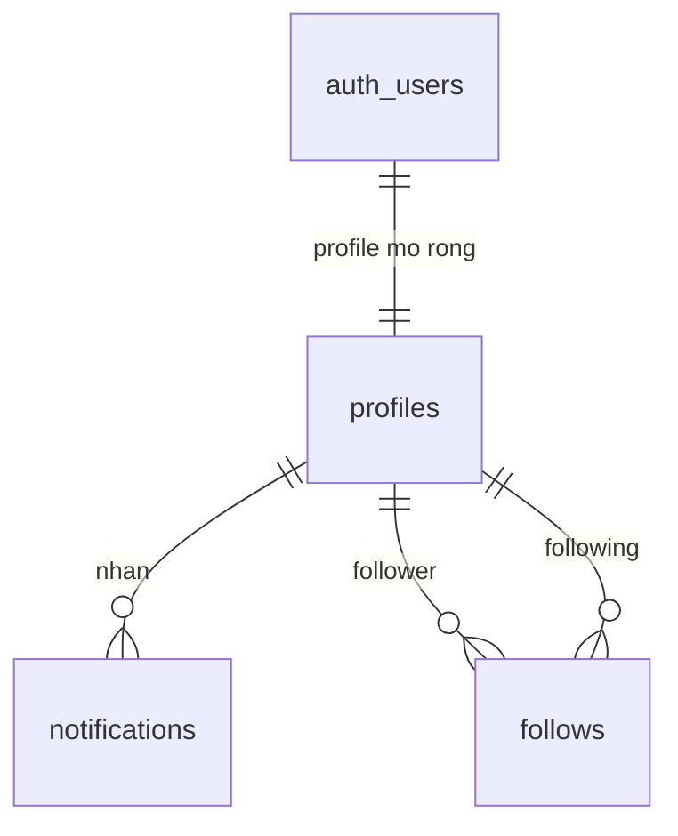
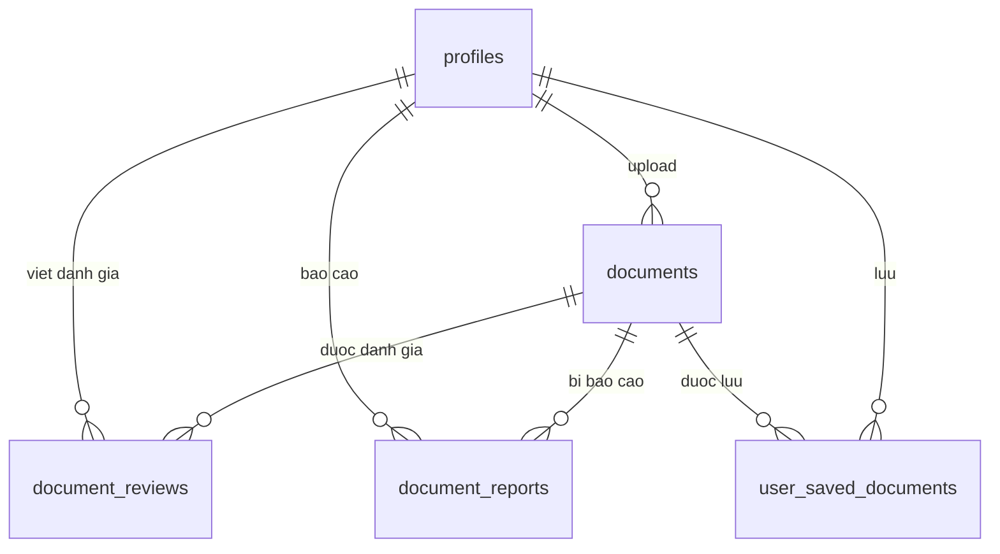
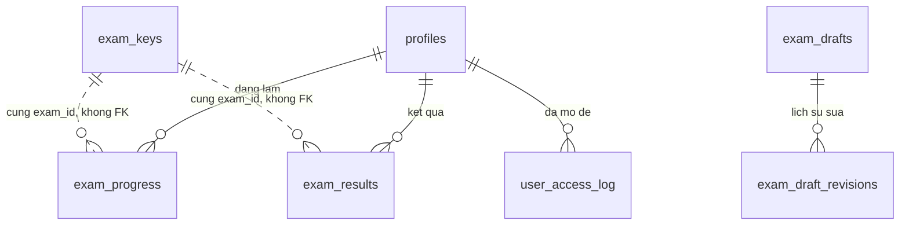
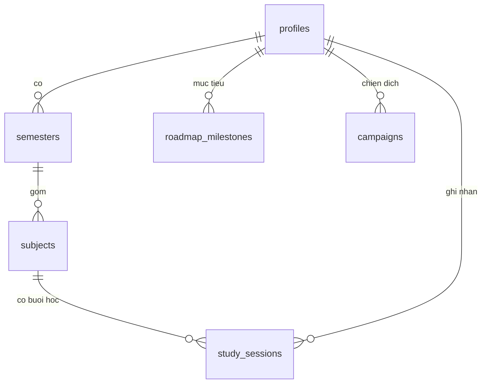
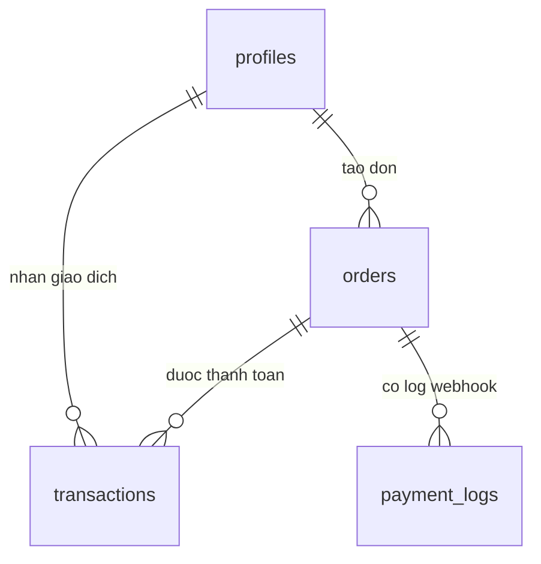

# Huong Dan Hoc Database Cua Web

File nay viet lai schema theo cach de hoc thiet ke database. Neu can chi tiet day du ve cot, index va RLS policy, xem `DATABASE_SCHEMA.md`.

## Cach Doc Nhanh

| Ky hieu | Y nghia | Vi du trong database |
| --- | --- | --- |
| PK | Primary key, khoa chinh de dinh danh moi dong | `profiles.id`, `documents.id` |
| FK | Foreign key, khoa ngoai tro sang bang khac | `documents.uploaded_by -> profiles.id` |
| UNIQUE | Khong cho trung gia tri hoac cap gia tri | `user_saved_documents(user_id, document_id)` |
| 1-1 | Mot dong bang A ung voi mot dong bang B | `auth.users` va `profiles` |
| 1-N | Mot dong bang A co nhieu dong bang B | `profiles` co nhieu `documents` |
| N-N | Nhieu dong A lien ket nhieu dong B qua bang trung gian | `profiles` luu nhieu `documents` qua `user_saved_documents` |
| JSONB | Du lieu linh hoat dang JSON, it rang buoc hon cot rieng | `exam_keys.answer_key`, `exam_drafts.content_json` |
| RLS | Row Level Security, luat bao mat theo tung dong | Nguoi dung chi xem du lieu cua minh |

## Tong Quan

Database hien tai co:

- 28 table trong schema `public`
- 1 view: `public_profile_view`
- 32 foreign key
- 93 index
- 83 RLS policy

Co the chia database thanh 6 nhom nghiep vu:

| Nhom | Bang chinh | Muc dich |
| --- | --- | --- |
| Tai khoan va ho so | `profiles`, `public_profile_view`, `notifications`, `follows` | Luu thong tin user, thong bao, quan he follow |
| Thu vien tai lieu | `documents`, `document_reviews`, `document_reports`, `user_saved_documents` | Upload, danh gia, bao cao, luu tai lieu |
| De thi va lam bai | `exam_keys`, `exam_progress`, `exam_results`, `exam_subjects`, `user_access_log` | Dap an, bai dang lam, ket qua, mon thi, luot truy cap de |
| Tao va dong bo de thi | `exam_drafts`, `exam_draft_revisions`, `exam_import_jobs`, `sync_logs`, `deleted_exam_tombstones` | Workflow admin/import/sync/xoa de |
| Hoc tap va lo trinh | `semesters`, `subjects`, `study_sessions`, `user_grades`, `roadmap_milestones`, `campaigns`, `school_scores` | Hoc ky, mon hoc, buoi hoc, diem, muc tieu, diem chuan |
| Thanh toan VIP | `orders`, `transactions`, `payment_logs` | Don hang, giao dich ngan hang, log webhook |

## So Do Quan He Rut Gon

### Tai khoan va ho so

Y tuong thiet ke: Supabase co san bang `auth.users` de dang nhap. Bang `profiles` mo rong thong tin rieng cua app. `profiles.id` vua la PK vua la FK toi `auth.users.id`, day la mau thiet ke 1-1 rat hay gap.

### Thu vien tai lieu

Y tuong thiet ke: `user_saved_documents` la bang trung gian de bieu dien quan he N-N giua user va tai lieu. Moi user co the luu nhieu tai lieu, moi tai lieu co the duoc nhieu user luu.

### De thi va ket qua

Y tuong thiet ke: `exam_keys.exam_id` la khoa chinh dang text, nhung `exam_results.exam_id` va `exam_progress.exam_id` chua co FK toi `exam_keys`. Day co the la do de thi den tu file/static data, khong phai tat ca de deu co dong trong database.

### Hoc ky, mon hoc, buoi hoc

Y tuong thiet ke: day la chuoi quan he 1-N ro rang: user co nhieu hoc ky, hoc ky co nhieu mon, mon co nhieu buoi hoc.

### Thanh toan VIP

Y tuong thiet ke: `orders` la y dinh thanh toan, `transactions` la giao dich thuc nhan, `payment_logs` la log ky thuat de doi soat. Trang thai VIP cuoi cung duoc luu trong `profiles.is_vip` va `profiles.vip_expired_at`.

## The Hoc Tung Bang

### 1. `profiles`

- Vai tro: ho so nguoi dung cua app.
- PK: `id`.
- FK: `id -> auth.users.id`.
- Quan he: la bang trung tam, duoc nhieu bang khac tro ve qua `user_id`.
- Bai hoc thiet ke: day la cach mo rong bang auth co san cua Supabase ma khong sua truc tiep `auth.users`.

### 2. `public_profile_view`

- Vai tro: view cong khai/thu gon tu `profiles`.
- Chua cac truong hien thi nhu `display_name`, `avatar_url`, `role`, `university`, `is_vip`.
- Bai hoc thiet ke: view dung de che bot cot nhay cam hoac tao API doc don gian hon.

### 3. `notifications`

- Vai tro: thong bao gui cho user.
- PK: `id`.
- FK: `user_id -> profiles.id`.
- Quan he: mot user co nhieu notification.
- Cot dang chu y: `is_read` de danh dau da doc.

### 4. `follows`

- Vai tro: quan he theo doi giua cac user.
- PK: `id`.
- FK: `follower_id -> profiles.id`, `following_id -> profiles.id`.
- UNIQUE: `(follower_id, following_id)`.
- Bai hoc thiet ke: day la quan he user-to-user N-N bang cach dung 2 FK cung tro ve `profiles`.

### 5. `documents`

- Vai tro: tai lieu nguoi dung upload hoac he thong hien thi.
- PK: `id`.
- FK: `uploaded_by -> profiles.id`.
- Quan he: mot profile co the upload nhieu document.
- Cot dang chu y: `file_url`, `file_type`, `downloads_count`, `avg_rating`, `is_public`, `education_level`, `major`.
- Bai hoc thiet ke: bang nay tron ca metadata file va thong tin hien thi/search.

### 6. `document_reviews`

- Vai tro: danh gia tai lieu.
- PK: `id`.
- FK: `document_id -> documents.id`, `user_id -> profiles.id`.
- UNIQUE: `(document_id, user_id)`.
- Rang buoc: `rating` tu 1 den 5.
- Bai hoc thiet ke: UNIQUE giup moi user chi danh gia mot lan tren moi document.

### 7. `document_reports`

- Vai tro: bao cao tai lieu co van de.
- PK: `id`.
- FK: `document_id -> documents.id`, `reported_by -> profiles.id`.
- Co unique index tren `(document_id, reported_by)`.
- Bai hoc thiet ke: giong review, nen chan mot user bao cao lap lai cung mot tai lieu.

### 8. `user_saved_documents`

- Vai tro: danh sach tai lieu user da luu.
- PK: `id`.
- FK: `user_id -> profiles.id`, `document_id -> documents.id`.
- UNIQUE: `(user_id, document_id)`.
- Bai hoc thiet ke: day la bang trung gian N-N kinh dien.

### 9. `exam_subjects`

- Vai tro: danh muc mon thi.
- PK: `id` dang `text`.
- Cot dang chu y: `name`, `icon`, `color`, `display_order`.
- Bai hoc thiet ke: bang danh muc nho, dung de hien thi filter/menu.

### 10. `exam_keys`

- Vai tro: dap an chuan cua de thi.
- PK: `exam_id` dang `text`.
- Cot dang chu y: `answer_key` JSONB, `resources` JSONB, `scoring_format`, `subject_folder`.
- Rang buoc: `scoring_format` chi nhan `flat` hoac `legacy`.
- Bai hoc thiet ke: JSONB linh hoat cho dap an phuc tap, nhung kho validate hon so voi tach thanh nhieu bang chi tiet.

### 11. `exam_progress`

- Vai tro: auto-save bai dang lam.
- PK: `id`.
- FK: `user_id -> profiles.id`.
- UNIQUE: `(user_id, exam_id)`.
- Cot dang chu y: `answers`, `answers_snapshot`, `time_left_seconds`, `status`.
- Bai hoc thiet ke: UNIQUE dam bao moi user chi co mot ban progress cho mot de.

### 12. `exam_results`

- Vai tro: ket qua sau khi nop bai.
- PK: `id`.
- FK: `user_id -> profiles.id`.
- Cot dang chu y: `exam_id`, `score`, `max_score`, `correct_count`, `answers_snapshot`, `submitted_at`.
- Bai hoc thiet ke: day la bang su kien/lich su, mot user co the co nhieu lan nop bai.

### 13. `user_access_log`

- Vai tro: ghi nhan user da truy cap de nao.
- PK: `id`.
- FK: `user_id -> profiles.id`.
- UNIQUE: `(user_id, exam_id)`.
- Bai hoc thiet ke: bang nay dung de dem "de moi" va tranh dem trung.

### 14. `exam_drafts`

- Vai tro: ban nhap de thi trong workflow tao de.
- PK: `id`.
- FK: `created_by -> auth.users.id`.
- Cot dang chu y: `content_json`, `answer_key_json`, `status`, `published_at`.
- Rang buoc: `status` chi nhan `draft` hoac `published`.
- Bai hoc thiet ke: dung JSONB de luu noi dung de khi cau truc cau hoi co the thay doi.

### 15. `exam_draft_revisions`

- Vai tro: lich su phien ban cua `exam_drafts`.
- PK: `id`.
- FK: `draft_id -> exam_drafts.id`, `created_by -> auth.users.id`.
- UNIQUE: `(draft_id, revision_no)`.
- Bai hoc thiet ke: bang revision giup truy vet va rollback noi dung.

### 16. `exam_import_jobs`

- Vai tro: job import de thi tu file.
- PK: `id`.
- FK: `created_by -> auth.users.id`.
- Cot dang chu y: `filename`, `status`, `parse_error`, `preview_json`.
- Bai hoc thiet ke: tach job import thanh bang rieng giup theo doi tien trinh va loi.

### 17. `deleted_exam_tombstones`

- Vai tro: ghi dau de thi da bi xoa.
- PK: `id`.
- FK: `deleted_by -> auth.users.id`.
- UNIQUE: `identity_key`.
- Bai hoc thiet ke: tombstone dung khi can nho rang mot item da xoa de tranh sync lai.

### 18. `sync_logs`

- Vai tro: log dong bo de thi/tai nguyen.
- PK: `id`.
- Cot dang chu y: `exam_id`, `status`, `action`, `details`.
- Bai hoc thiet ke: log ky thuat thuong dung JSONB `details` de luu thong tin phu.

### 19. `semesters`

- Vai tro: hoc ky cua user.
- PK: `id`.
- FK: `user_id -> profiles.id`.
- Quan he: mot user co nhieu semester.
- Cot dang chu y: `status`, `total_credits`, `gpa`.
- Bai hoc thiet ke: `status` co check constraint giup du lieu nhat quan.

### 20. `subjects`

- Vai tro: mon hoc trong hoc ky.
- PK: `id`.
- FK: `semester_id -> semesters.id`, `user_id -> profiles.id`.
- Quan he: mot semester co nhieu subject.
- Cot dang chu y: `credits`, `grade_letter`, `grade_number`, `expected_grade`, `progress_percentage`.
- Bai hoc thiet ke: `user_id` co the duoc xem la cot denormalize vi da suy ra duoc qua `semester_id -> semesters.user_id`. Dieu nay giup query nhanh hon nhung co nguy co lech du lieu neu khong kiem soat.

### 21. `study_sessions`

- Vai tro: buoi hoc/lan hoc cua user.
- PK: `id`.
- FK: `user_id -> profiles.id`, `subject_id -> subjects.id`.
- Quan he: mot subject co nhieu study session.
- Cot dang chu y: `study_date`, `duration_minutes`, `focus_score`, `notes`.
- Rang buoc: `focus_score` tu 1 den 5.

### 22. `user_grades`

- Vai tro: bang diem don gian cua user.
- PK: `id`.
- Cot dang chu y: `user_id`, `subject`, `credits`, `score`.
- Diem dang hoc: `user_id` hien chua co FK trong schema export. Neu day la du lieu quan trong, nen can nhac FK toi `profiles.id` hoac `auth.users.id`.

### 23. `roadmap_milestones`

- Vai tro: cac moc lo trinh hoc tap cua user.
- PK: `id`.
- FK: `user_id -> profiles.id`.
- Cot dang chu y: `mode`, `sort_order`, `title`, `status`, `progress`.
- Rang buoc: `progress` tu 0 den 100, `status` gom `done`, `active`, `locked`.

### 24. `campaigns`

- Vai tro: chien dich/muc tieu hoc tap.
- PK: `id`.
- FK: `user_id -> profiles.id`.
- Cot dang chu y: `title`, `description`, `targets`, `start_date`, `end_date`, `is_completed`, `is_public`.
- Bai hoc thiet ke: `targets` la JSONB nen linh hoat, phu hop khi moi campaign co nhieu loai muc tieu khac nhau.

### 25. `school_scores`

- Vai tro: diem chuan truong/nganh.
- PK: `id`.
- Khong co FK.
- Cot dang chu y: `university_name`, `university_code`, `major_name`, `subject_groups`, `score`, `method`, `year`.
- Bai hoc thiet ke: day la bang tham chieu/public data. Neu du lieu lon hon, co the tach `universities` va `majors`.

### 26. `orders`

- Vai tro: don mua goi VIP.
- PK: `id`.
- FK: `user_id -> profiles.id`.
- Cot dang chu y: `package_id`, `amount`, `vip_days`, `status`, `transfer_code`.
- Rang buoc: `package_id` gom `1m`, `3m`, `1y`; `status` gom `pending`, `paid`, `expired`.
- Bai hoc thiet ke: order ghi "y dinh thanh toan", chua chac da co tien vao.

### 27. `transactions`

- Vai tro: giao dich ngan hang thuc nhan.
- PK: `id`.
- FK: `order_id -> orders.id`, `user_id -> profiles.id`.
- UNIQUE: `tid`.
- Cot dang chu y: `amount`, `description`, `bank`, `processed_at`, `raw_data`.
- Bai hoc thiet ke: UNIQUE tren `tid` giup mot giao dich khong duoc xu ly hai lan.

### 28. `payment_logs`

- Vai tro: log webhook thanh toan.
- PK: `id`.
- FK: `order_id -> orders.id`, `user_id -> auth.users.id`.
- Cot dang chu y: `raw_payload`, `payload`, `status`, `error_message`, `provider`.
- Bai hoc thiet ke: log nen giu payload goc de doi soat khi co loi.

## Nhung Mau Thiet Ke Dang Hoc Duoc Tu Database Nay

### 1. Bang trung tam va bang phu

`profiles` la bang trung tam. Nhieu bang khac co `user_id` tro ve `profiles.id`. Day la mau phu hop cho ung dung co user la trung tam.

### 2. Bang trung gian cho quan he N-N

Co 3 vi du rat ro:

- `user_saved_documents`: user luu tai lieu.
- `document_reviews`: user danh gia tai lieu.
- `follows`: user theo doi user.

Diem chung: deu co 2 FK va mot UNIQUE tren cap FK de chan trung.

### 3. Bang lich su/su kien

`exam_results`, `transactions`, `payment_logs`, `sync_logs`, `user_access_log` la cac bang ghi lai su kien da xay ra. Cac bang nay thuong co `created_at`, `submitted_at`, `processed_at` hoac timestamp tuong tu.

### 4. Bang trang thai hien tai

`exam_progress`, `orders`, `profiles` luu trang thai hien tai:

- `exam_progress.status`: dang lam hay da nop.
- `orders.status`: pending, paid, expired.
- `profiles.is_vip`: user dang VIP hay khong.

### 5. JSONB cho du lieu linh hoat

JSONB xuat hien o:

- `exam_keys.answer_key`
- `exam_keys.resources`
- `exam_drafts.content_json`
- `exam_drafts.answer_key_json`
- `exam_progress.answers`
- `profiles.roadmap_data`
- `campaigns.targets`
- `payment_logs.payload`

Bai hoc: JSONB tot khi cau truc thay doi nhieu, nhung neu can filter/search/validate manh thi nen tach thanh bang/cot rieng.

### 6. Check constraint giup chan du lieu sai

Vi du:

- `document_reviews.rating` tu 1 den 5.
- `orders.status` chi nhan `pending`, `paid`, `expired`.
- `roadmap_milestones.progress` tu 0 den 100.
- `subjects.status` chi nhan `planned`, `in_progress`, `completed`.

### 7. Cascade va set null

Mot so FK co `on delete cascade`, nghia la xoa cha thi xoa con. Vi du xoa `profiles` se xoa `exam_results`, `orders`, `notifications` cua user.

Mot so FK co `on delete set null`, nghia la xoa cha thi cot FK o bang con thanh NULL. Vi du `documents.uploaded_by` set null de tai lieu co the con ton tai du nguoi upload bi xoa.

## Diem Nen Chu Y Khi Hoc Thiet Ke

| Diem | Vi sao dang hoc |
| --- | --- |
| `profiles.id` vua PK vua FK | Mau 1-1 voi bang auth co san |
| `user_saved_documents(user_id, document_id)` UNIQUE | Cach chan trung trong bang trung gian |
| `exam_results.exam_id` khong FK toi `exam_keys` | Co the la chu y thiet ke, nhung cung la diem can can nhac neu muon toan ven du lieu |
| `user_grades.user_id` chua co FK | Vi du tot de thay FK quan trong the nao |
| `subjects.user_id` co the suy ra qua `semester_id` | Vi du ve denormalization: nhanh hon nhung can giu nhat quan |
| Nhieu cot JSONB | Linh hoat, nhung it rang buoc hon thiet ke quan he chuan |
| `payment_logs` luu payload goc | Thiet ke tot cho audit/debug |

## Bai Tap Tu Hoc Tren Database Nay

1. Ve lai ERD chi gom 5 bang: `profiles`, `documents`, `document_reviews`, `document_reports`, `user_saved_documents`.
2. Giai thich vi sao `user_saved_documents` can UNIQUE `(user_id, document_id)`.
3. Tim tat ca bang co `user_id` va chia thanh 2 nhom: co FK va chua co FK.
4. Chon mot JSONB field, thu thiet ke lai thanh bang quan he rieng.
5. So sanh `orders`, `transactions`, `payment_logs`: moi bang dai dien cho su kien hay trang thai nao?
6. Tim cac bang co check constraint va giai thich constraint do chan loi gi.
7. Tu bang `semesters`, `subjects`, `study_sessions`, viet cau: "Mot user co nhieu ..., moi ... co nhieu ...".

## Goi Y Neu Muon Cai Thien Thiet Ke Sau Nay

- Can nhac them FK cho `user_grades.user_id`.
- Can nhac co nen tao bang `categories` thay vi luu `documents.category` va `documents.category_id` dang text.
- Can nhac FK logic giua `exam_results.exam_id`, `exam_progress.exam_id`, `user_access_log.exam_id` va `exam_keys.exam_id` neu tat ca de thi deu co key trong database.
- Can nhac tach cac JSONB lon thanh bang con neu can query thong ke chi tiet.
- Giu RLS cho cac bang user data, vi schema `public` cua Supabase co the duoc truy cap qua API.
