# DTHT Platform — Trạm Học Sinh Sinh Viên

Nền tảng web học tập cho học sinh THPT và sinh viên Việt Nam: công cụ học tập, lộ trình, thư viện tài liệu, và bộ phân tích tuyển sinh đại học.

[](./docs/architecture.html)

---

## Kiến trúc hệ thống

Sơ đồ dưới đây là artifact HTML độc lập (dark/light theme, có chuyển động, phóng to được). Bấm vào ảnh để mở bản tương tác, hoặc mở file trực tiếp: [`docs/architecture.html`](./docs/architecture.html).

> **Lưu ý về phạm vi:** sơ đồ là bản mô tả khái quát (high-level), không phải sơ đồ triển khai chi tiết. Nó thể hiện 11 thành phần lõi, 2 ranh giới tin cậy, và **một luồng chính** từ người học tới dữ liệu. Luồng quản trị (`dtht.py`) được vẽ nét đứt vì chạy ngoài băng (out-of-band), không nằm trong đường tải của người dùng cuối.

<div align="center">

[](./docs/architecture.html)

</div>

<sub>Bản SVG tối: [`docs/architecture-dark.svg`](./docs/architecture-dark.svg)</sub>

### Luồng chính (primary path)

```
Students → Vercel Edge (CDN) → DTHT SPA (React 19) → Study Engine
                                                          │
                                                          ▼
                                          Postgres RPC (SECURITY DEFINER)
                                                          │
                                                          ▼
                                              PostgreSQL DB (RLS enforced)
```

1. **Người học** truy cập qua HTTPS; tài nguyên tĩnh được phục vụ từ **Vercel Edge**.
2. **DTHT SPA** (React 19 + Vite) khởi động, nạp các route lazy.
3. **Study Engine** (`useStudyTracker`) phát session heartbeat và gọi RPC.
4. Mọi thay đổi nhạy cảm (EXP, VIP, session) đi qua **Postgres RPC `SECURITY DEFINER`** — browser **không** ghi trực tiếp vào bảng.
5. Dữ liệu lưu ở **PostgreSQL** với **Row-Level Security** siết chặt.
6. Xác thực qua **Supabase Auth** (PKCE, session JWT); tài liệu/PDF đề thi lấy từ **Supabase Storage**.

### Ranh giới (boundaries)

| Ranh giới | Thành phần bên trong | Ý nghĩa |
| --- | --- | --- |
| **Client Runtime** (Browser / Edge) | `Vercel Edge`, `DTHT SPA`, `Study Engine` | Chạy trên máy người dùng và CDN; chỉ giữ `VITE_SUPABASE_ANON_KEY` |
| **Supabase Cloud Platform** (RLS Enforced) | `Supabase Auth`, `Postgres RPC`, `Supabase Storage`, `PostgreSQL DB` | Ranh giới tin cậy; mọi truy cập đều bị RLS/RPC kiểm soát |

### Thành phần & phụ thuộc ngoài

| Thành phần | Vai trò | Phụ thuộc ngoài |
| --- | --- | --- |
| `Vercel Edge` | CDN, static assets, cache immutable | Vercel |
| `DTHT SPA` | 15 route: `/home`, `/gpa`, `/library`, `/arena`, `/admission`, `/tim-truong`, `/hoc-online`, … | — |
| `Study Engine` | EXP v2, heartbeat session, rank/level | — |
| `Supabase Auth` | Đăng nhập, session JWT | Supabase |
| `Postgres RPC` | `start_study_session`, `heartbeat_study_session`, `end_study_session`, `award_study_exp`, … | — |
| `Supabase Storage` | PDF đề thi, hình ảnh câu hỏi | Supabase |
| `PostgreSQL DB` | Bảng dữ liệu + RLS policies | Supabase |
| `DTHT CLI Tool` (`dtht.py`) | Discover / sync / sync-db / logs / build / backup đề thi | — |
| `Google Gemini` | Chuẩn hoá `.docx` → Markdown + KaTeX | Google AI API |

> Sơ đồ nguồn: [`docs/architecture.json`](./docs/architecture.json) — chỉnh file này rồi render lại bằng Archify.

---

## Bắt đầu nhanh

```bash
npm install
cp .env.example .env      # điền biến môi trường
npm run dev               # http://localhost:5173
```

### Biến môi trường

Xem [`.env.example`](./.env.example). Tóm tắt:

| Biến | Dùng ở đâu | Ghi chú |
| --- | --- | --- |
| `VITE_SUPABASE_URL` | Browser | Public |
| `VITE_SUPABASE_ANON_KEY` | Browser | Public, bị giới hạn bởi RLS |
| `SUPABASE_SERVICE_ROLE_KEY` | Tooling (`scripts/`, `lib/`) | **Bí mật — không bao giờ đưa vào browser** |
| `GEMINI_API_KEY` | `lib/raw_extractor.py` | Bí mật |
| `ADMIN_TOKEN` | API nội bộ | Bí mật |

### Lệnh

| Lệnh | Tác dụng |
| --- | --- |
| `npm run dev` | Dev server (Vite HMR) |
| `npm run build` | Build production → `dist/` |
| `npm run lint` | ESLint flat config |
| `npm run preview` | Xem thử bản build |
| `node scripts/test-admission.mjs` | Bộ 102 test cho engine tuyển sinh |

---

## Cấu trúc repository

| Thư mục | Vai trò | Tài liệu |
| --- | --- | --- |
| `src/` | SPA React 19, Vite, Tailwind v4 — UI, contexts, hooks, admissions engine | [`src/EGM.md`](./src/EGM.md) |
| `supabase/` | Ranh giới CSDL: migration ledger, RLS, RPC, seed tuyển sinh | [`supabase/EGM.md`](./supabase/EGM.md) |
| `lib/` | Package Python dùng chung: parse JSON đề thi, pipeline Gemini, Supabase service-role | [`lib/EGM.md`](./lib/EGM.md) |
| `scripts/` | CLI vận hành: soạn đề, crawl/merge tuyển sinh, introspection schema | [`scripts/EGM.md`](./scripts/EGM.md) |
| `skills/` | Thư viện Agent Skills (chuẩn mở) cho trợ lý lập trình | [`skills/EGM.md`](./skills/EGM.md) |
| `docs/` | Sơ đồ kiến trúc + design docs | [`docs/designs/SITEMAP.md`](./docs/designs/SITEMAP.md) |
| `public/data/` | Dataset tĩnh: đề thi, điểm chuẩn, phổ điểm | — |
| `data/` | Nguồn dữ liệu tuyển sinh thô (đầu vào pipeline merge) | — |

---

## Bất biến toàn cục

- **Tách biệt front-end và tooling.** Code trong `src/` **không bao giờ** import từ `scripts/`, `lib/`, hay `supabase/`. Tooling dùng service-role key; browser dùng anon key và chịu RLS.
- **Truy cập CSDL qua `SECURITY DEFINER`.** Thay đổi trên dữ liệu nhạy cảm (EXP, VIP, session) phải đi qua RPC với `search_path` được ghim; ghi trực tiếp từ browser bị RLS chặn.
- **Hash tài nguyên bất biến.** Bản build production đặt tên `assets/[name]-[hash].[ext]` để cache dài hạn trên CDN.
- **Runtime production tinh gọn.** `pdfjs-dist` và `react-pdf` đã bị gỡ; `katex` chỉ còn ở `devDependencies` phục vụ script ngoài băng; `public/pdf.worker.min.mjs` (1.37 MB) đã xoá.
- **Schema tài nguyên đề thi thống nhất.** Mọi `exam.json` dùng đúng một block `resources` (xem bên dưới).
- **Một Supabase client duy nhất.** Frontend chỉ dùng singleton từ `src/lib/supabase.js`.

### Schema tài nguyên đề thi

```json
{
  "resources": {
    "exam_file_url": null,
    "answer_file_url": null,
    "answer_file_name": null,
    "video_url": null,
    "edit_link": null
  }
}
```

- Chỉ dùng `snake_case`; URL ngoài phải đầy đủ `https://...`; file nội bộ dùng tên tương đối (`de-goc.pdf`).
- Giữ `index.json` gọn — tài nguyên nằm trong từng `exam.json`.

---

## Công cụ vận hành

### `dtht.py`

| Lệnh | Tác dụng |
| --- | --- |
| `status` | Liệt kê manifest đề thi, số câu, trạng thái đáp án/link (`--source {public,source,both}`) |
| `sync` | Làm sạch `exam.json` cục bộ, sinh bản public không chứa đáp án |
| `sync-db` | Đẩy answer key và resource URL lên Supabase (`exam_keys`, `exams`) |
| `delete-keys` | Xoá answer key khỏi Supabase (**phá huỷ**) |
| `logs` | Xem log đồng bộ gần đây từ `sync_logs` |
| `build` | Chạy `npm run build` và ghi log |
| `push` | Tự động commit + push cập nhật catalog đề thi |
| `backup` | Tạo zip backup có timestamp cho dataset đề thi |

### Môi trường build (`vite.config.js`)

- React Fast Refresh, Tailwind v4, nén kép Gzip + Brotli cho bundle > 1 KB.
- `manualChunks`: `vendor-react` và `vendor-supabase`.
- Target `es2020`, minify `esbuild`, ngưỡng cảnh báo chunk 600 kB.

---

## Kiểm thử & xác minh

```bash
npm run lint && npm run build
```

- **Không có `supabase db push`.** Thư mục `supabase/` không có `config.toml`; migration được áp qua Supabase dashboard/SQL editor. Đừng ghi lệnh CLI vào quy trình kiểm thử.
- `supabase/schema.sql` là **file rỗng 0 byte**, không phải nguồn schema. Nguồn sự thật là `supabase/migrations/` và database đang chạy.
- `scripts/` là công cụ ad hoc, không có test runner riêng.

---

## Hiệu ứng phụ & rủi ro

- **Trạng thái Supabase cloud** bị thay đổi bởi migration, seed data và thao tác client.
- **Hệ thống file cục bộ**: `scripts/` và `dtht.py` đọc/ghi JSON, ảnh câu hỏi, bundle KaTeX.
- **Dịch vụ AI bên ngoài**: `lib/raw_extractor.py` gọi Google Gemini khi bật `--ai`.
- **Gọi mạng từ trong Postgres**: `reconcile_vip_payment` đọc secret từ Vault và gọi `https://thueapibank.vn/...` — tính đúng đắn của thanh toán phụ thuộc dịch vụ ngoài.
- **Mất dữ liệu không hồi phục**: migration `20260613000000` + `20260614064500` drop 17 bảng `CASCADE`. Phải export trước.
- **25/69 file migration chỉ có comment** — neo timestamp ledger với thay đổi được áp ngoài băng. **Không** "sửa" bằng cách thêm DDL.

---

## Giấy phép

Chưa công bố giấy phép trong repository này.
