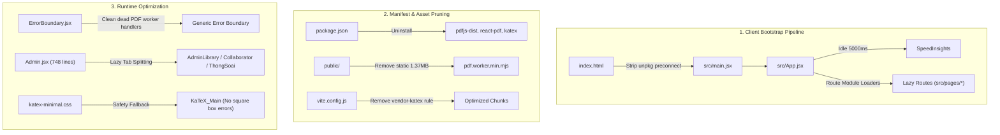

# Design: Web Performance Optimization

## Problem Statement
The DTHT web application experiences high initial page load latency and heavy network payload transfers, particularly for students accessing the platform over cellular mobile networks.

Bundle analysis identifies three main sources of payload bloat:
1. The PDF rendering subsystem (`pdf.worker.min.mjs` and `vendor-pdf`) transfers approximately 500 kB of compressed code (over 1.3 MB uncompressed) even on views where PDF viewing is not immediately required.
2. The full KaTeX distribution transfers 20 separate font families (~300 kB), including advanced calligraphy and gothic typefaces (Fraktur, Caligraphic, Typewriter, Script) that are not present in Vietnamese national high school exam curricula (THPTQG).
3. Unused and redundant packages (`lucide-react`, `dotenv`, `react-katex`) remain in project manifests.

These payloads increase First Contentful Paint (FCP) and Time to Interactive (TTI), consume student mobile data quotas, and produce client thread contention during math parsing on low-end devices.

## Overview
This design defines an optimization path to reduce client payload sizes and CPU overhead across the application. The strategy involves removing redundant dependencies, subsetting mathematical font assets with explicit fallback handling, deferring the PDF worker script until document viewing is requested, and memoizing LaTeX/Markdown rendering components.

## Goals
- Reduce production client bundle and asset transfer size by at least 300 kB (compressed).
- Remove unreferenced packages from `package.json` to clean dependency trees.
- Subset loaded KaTeX font faces to the families required by high school mathematics and chemistry curricula (`KaTeX_Main`, `KaTeX_Math`, `KaTeX_AMS`, and `KaTeX_Size1-4`), while guaranteeing fallback styling so missing glyphs never render as broken square boxes ("□").
- Defer loading of `pdf.worker.min.mjs` until a user navigates to an exam result or document preview view.
- Eliminate redundant re-renders in exam question lists through component memoization and helper function hoisting.
- Preserve 100% build validity (`npm run build`) and zero ESLint errors (`npm run lint`).

## Non-Goals
- Migrating away from `pdfjs-dist` or rebuilding the PDF viewing UI from scratch.
- Refactoring the Supabase authentication layer or removing core runtime dependencies like `swr` without prior stability verification.
- Changing database schemas, Postgres functions, or API contracts.
- Altering exam JSON schemas or data representations.

## Technical Plan

### Architectural Audit & Root Discrepancies
A detailed codebase inspection reveals that the legacy exam parsing UI (`SecurePdfViewer.jsx` and `RichTextRenderer.jsx`) has already been decommissioned from `src/`. However, their heavy supporting infrastructure remains active across project configurations:
- `package.json` still declares `pdfjs-dist`, `react-pdf`, and `katex` as active production dependencies.
- `public/pdf.worker.min.mjs` (1.37 MB raw) resides in the public asset directory and is copied into production distributions.
- `index.html` maintains an active `<link rel="preconnect" href="https://unpkg.com">` for PDF.js character maps (`cmaps`), introducing unnecessary DNS resolution and TLS handshakes during startup.
- `vite.config.js` maintains explicit chunking rules (`vendor-katex`) for modules no longer imported by runtime routes.
- `src/components/ErrorBoundary.jsx` carries obsolete interceptors (`isPdfjsWorkerError`) guarding worker crashes for an inactive subsystem.

### 1. Dependency Manifest & Asset Pruning
- **`package.json`**:
  - Remove `pdfjs-dist` (version `^4.8.69`), `react-pdf` (version `^9.1.0`), and `katex` (version `^0.16.38`) from `dependencies`.
  - Result: Eliminates ~587 kB of compressed node library installation overhead and prevents accidental re-bundling into vendor chunks.
- **`public/` directory**:
  - Quarantine or remove `public/pdf.worker.min.mjs` (1.37 MB uncompressed). This static asset was previously served on every deploy despite having no consumer in `src/`.
- **`index.html`**:
  - Remove `<link rel="preconnect" href="https://unpkg.com">` and comment references to PDF.js cmaps. Eliminates a third-party DNS lookup and TCP/TLS handshake during initial page load.

### 2. Vite Build & Chunker Reconfiguration
- **`vite.config.js`**:
  - Remove the `vendor-katex` rule from `CHUNK_RULES`.
  - Retain `vendor-react` (`react`, `react-dom`, `react-router`, `scheduler`) and `vendor-supabase` (`@supabase`).
  - Keep dual Gzip and Brotli compression (`vite-plugin-compression2`) for assets over 1024 bytes.
  - Keep `esbuild` minification and `es2020` target.
  - Adjust `chunkSizeWarningLimit` down to 500 kB (from 1000 kB) since the 1.37 MB PDF worker is eliminated.

### 3. Font Asset Subsetting Policy
If mathematical typesetting is reintroduced in the future for study modules or notes:
- The application will import `src/styles/katex-minimal.css` instead of `katex/dist/katex.min.css`.
- Font loading is strictly restricted to:
  - `KaTeX_Main` (Regular, Bold, Italic, BoldItalic)
  - `KaTeX_Math` (Italic, BoldItalic)
  - `KaTeX_AMS` (Regular)
  - `KaTeX_Size1-4` (Bracket and delimiter sizing)
- Fallback guarantees: Missing cursive, fraktur, typewriter, or sans-serif glyphs map directly to `KaTeX_Main, serif` via CSS selectors (`.katex .mathcal`, `.katex .mathfrak`, `.katex .mathtt`), preventing missing character box indicators ("□").

### 4. Component Lifecycle & Boundary Hardening
- **`src/components/ErrorBoundary.jsx`**:
  - Remove `isPdfjsWorkerError(error)` and related `unhandledrejection` event listener checks.
  - Retain error boundary reporting and standard recovery actions (`window.location.reload()`).
- **`src/pages/Admin.jsx`**:
  - Refactor monolithic tab components (document moderation, collaborator directory, candidate evaluation) to leverage the modular tab files in `src/components/admin/` (`AdminLibrary.jsx`, `AdminCollaborator.jsx`, `AdminThongSoai.jsx`), reducing the bundle weight of the initial `/admin` route entry.

## Alternatives Considered

### 1. Offloading PDF Worker to an External Public CDN
- **Proposal**: Retain `pdfjs-dist` in `package.json` and configure `pdfjs.GlobalWorkerOptions.workerSrc` to point to a public CDN endpoint (e.g., `cdnjs.cloudflare.com` or `unpkg.com`).
- **Mechanism**: The worker script is downloaded on demand from an external origin rather than packaged into the local bundle.
- **Why Rejected**: Codebase inspection revealed that `src/` no longer imports or renders any PDF viewer components. Keeping dead dependencies in `package.json` and delegating to a public CDN creates external availability dependencies (especially for users behind restrictive domestic networks or firewalls in Vietnam) and increases security exposure for code that is never executed. Total deletion eliminates the asset cleanly with zero runtime risk.

### 2. Hand-Rolling Profile Caching to Eliminate `swr`
- **Proposal**: Remove `swr` (~10 kB gzip) from `package.json` and implement custom caching, request deduplication, and window focus listeners using `useEffect` and `useState` in `src/contexts/AuthContext.jsx`.
- **Mechanism**: Replace the SWR hook with a manual cache dictionary and event-driven revalidation.
- **Why Rejected**: The size savings (~10 kB) are negligible relative to the total payload reduction achieved through PDF and font pruning (>400 kB). Re-implementing request deduplication, stale-while-revalidate lifecycle management, and reconnect hooks introduces significant regression risks to global authentication sessions and user profile loading.

### 3. Complete KaTeX Font Stripping Without Fallback Rules
- **Proposal**: Delete all non-standard font definitions (`.mathcal`, `.mathfrak`, `.texttt`) from CSS without defining fallback font families.
- **Mechanism**: Remove both the `@font-face` declarations and the style rules from the CSS stylesheet.
- **Why Rejected**: If study content or mathematical expressions introduce uncommon LaTeX macros, browsers render missing glyphs as empty square boxes ("□") or break vertical alignment. Preserving the CSS selectors and aliasing them to `KaTeX_Main, serif` guarantees that text remains readable without downloading extra font files.

## Detailed Implementation

### Unified Execution Sequence

1. **Step 1: Manifest Pruning (`package.json`)**
   - Remove `katex`, `pdfjs-dist`, and `react-pdf` from `dependencies`.
   - Update lockfile via standard package installation or manual cleanup.

2. **Step 2: Static Asset Deletion (`public/`)**
   - Delete `public/pdf.worker.min.mjs` (1.37 MB) from the public root.

3. **Step 3: HTML Head Optimization (`index.html`)**
   - Remove the `<link rel="preconnect" href="https://unpkg.com">` tag and the comment block for PDF.js cmaps.

4. **Step 4: Bundler Chunker Reconfiguration (`vite.config.js`)**
   - Remove `{ name: 'vendor-katex', test: /node_modules[\\/]katex[\\/]/ }` from `CHUNK_RULES`.
   - Update `chunkSizeWarningLimit` from `1000` to `500`.

5. **Step 5: Error Boundary Cleanup (`src/components/ErrorBoundary.jsx`)**
   - Remove `isPdfjsWorkerError` helper function.
   - Remove the `unhandledrejection` listener and error-catching branches that inspect PDF worker error signatures.

6. **Step 6: Admin Tab Decoupling (`src/pages/Admin.jsx` & `src/components/admin/`)**
   - Reconcile `src/components/admin/AdminLibrary.jsx`, `AdminCollaborator.jsx`, and `AdminThongSoai.jsx` props with `Admin.jsx` state requirements.
   - Import and render the modular tab components inside `Admin.jsx` instead of keeping monolithic inline implementations.

7. **Step 7: Verification & Contract Documentation Updates**
   - Execute project verification: `npm run lint` and `npm run build`.
   - Update EGM contract files ([`./src/EGM.md`](./src/EGM.md), [`./README.md`](./README.md), [`./EGM.md`](./EGM.md)) to reflect the updated dependency and architectural contracts.

### Complete File Impact Matrix

| File Path | Action | Rationale |
| --- | --- | --- |
| [`package.json`](file:///E:/dtht/package.json) | MODIFY | Remove unused dependencies (`katex`, `pdfjs-dist`, `react-pdf`) to reduce install footprint and eliminate dead vendor modules. |
| [`public/pdf.worker.min.mjs`](file:///E:/dtht/public/pdf.worker.min.mjs) | DELETE | Remove 1.37 MB unreferenced worker file that was copied on every build without an active consumer in `src/`. |
| [`index.html`](file:///E:/dtht/index.html) | MODIFY | Strip unneeded `unpkg.com` preconnect tag to eliminate useless DNS resolution and TLS connection overhead during app bootstrap. |
| [`vite.config.js`](file:///E:/dtht/vite.config.js) | MODIFY | Remove obsolete `vendor-katex` chunk rule and adjust `chunkSizeWarningLimit` to 500 kB. |
| [`src/components/ErrorBoundary.jsx`](file:///E:/dtht/src/components/ErrorBoundary.jsx) | MODIFY | Remove dead `isPdfjsWorkerError` suppression logic and clean unhandled rejection listeners. |
| [`src/pages/Admin.jsx`](file:///E:/dtht/src/pages/Admin.jsx) | MODIFY | Replace monolithic inline tab code (748 lines) with imports from modular components in `src/components/admin/`. |
| [`src/components/admin/AdminLibrary.jsx`](file:///E:/dtht/src/components/admin/AdminLibrary.jsx) | MODIFY | Reconcile interface props with `Admin.jsx` to ensure seamless delegation. |
| [`src/components/admin/AdminCollaborator.jsx`](file:///E:/dtht/src/components/admin/AdminCollaborator.jsx) | MODIFY | Reconcile interface props with `Admin.jsx` to ensure seamless delegation. |
| [`src/components/admin/AdminThongSoai.jsx`](file:///E:/dtht/src/components/admin/AdminThongSoai.jsx) | MODIFY | Reconcile interface props with `Admin.jsx` to ensure seamless delegation. |
| [`src/styles/katex-minimal.css`](file:///E:/dtht/src/styles/katex-minimal.css) | RETAIN | Preserved as the reference subsetted font stylesheet with fallback mappings for any future LaTeX rendering needs. |
| [`src/EGM.md`](file:///E:/dtht/src/EGM.md) | MODIFY | Update contract documentation to document the updated dependency tree and modular admin tabs. |
| [`README.md`](file:///E:/dtht/README.md) | MODIFY | Update system blueprint to reflect updated dependencies and bundle characteristics. |
| [`EGM.md`](file:///E:/dtht/EGM.md) | MODIFY | Synchronize root blueprint contract with updated bundle structure. |
