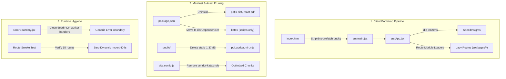

# Design: Web Performance Optimization

## Problem Statement
Excessive network payload transfers cause high initial page load latency across the DTHT (Trạm Học Sinh Sinh Viên) web application, particularly for students accessing the platform over cellular mobile networks (3G/4G).

Bundle and static asset inspection identifies three primary sources of payload bloat:
1. Dead PDF rendering infrastructure: A 1.37 MB static file (`public/pdf.worker.min.mjs`) is served and deployed on every build, and dead packages (`pdfjs-dist` and `react-pdf`) remain declared in project manifests despite the PDF viewer UI having been decommissioned from `src/`.
2. Unneeded external DNS queries: `index.html` maintains a legacy `<link rel="dns-prefetch" href="https://unpkg.com" />` tag originally added for PDF.js character maps (`cmaps`), causing unnecessary DNS lookups during app bootstrap.
3. Obsolete bundler chunk rules: `vite.config.js` maintains explicit chunking rules (`vendor-katex`) and stale warnings for dependencies that are no longer imported by active application routes.

These payloads increase First Contentful Paint (FCP) and Time to Interactive (TTI), consume student mobile data quotas, and inflate deployment build sizes.

## Overview
This design defines an optimization path to reduce client payload sizes and network latency. The strategy centers on eliminating decommissioned PDF assets, stripping dead DNS prefetch tags from the HTML entry point, moving out-of-band build dependencies to developer tooling manifests, and verifying dynamic route chunk health.

## Goals
- Reduce production deployment payload by 1.37 MB through static worker deletion and prune ~587 kB of unused node library weight from production runtime manifests.
- Remove dead runtime dependencies (`pdfjs-dist`, `react-pdf`) from `package.json` while isolating `katex` strictly as a `devDependency` to preserve out-of-band maintenance scripts.
- Eliminate dead `unpkg.com` DNS prefetch tags from `index.html`.
- Remove obsolete `vendor-katex` chunk rules and stale threshold comments from `vite.config.js`.
- Clean obsolete PDF worker interceptors from `src/components/ErrorBoundary.jsx`.
- Verify full build validity (`npm run build`), clean lint status (`npm run lint`), and runtime dynamic chunk resolution across all 15 application routes.

## Non-Goals
- Refactoring `src/pages/Admin.jsx`: Codebase audit confirmed that existing replicas in `src/components/admin/` contain unindexed client scans (`AdminThongSoai.jsx`), blocking `window.alert()` calls, and lack directory RPC fallbacks. Administrative UI modularization is tracked in a dedicated maintainability task.
- Refactoring the Supabase authentication layer or altering `swr` dependencies in `src/contexts/AuthContext.jsx`.
- Changing database schemas, Postgres functions, or Row-Level Security (RLS) policies.
- Altering exam JSON schemas or storage structures.

## Technical Plan

### Architectural Audit & Scope Boundaries
Codebase inspection confirms that the legacy exam parsing UI (`SecurePdfViewer.jsx` and `RichTextRenderer.jsx`) was decommissioned from `src/`. However, lingering supporting configurations remain active:
- `package.json` declares `pdfjs-dist`, `react-pdf`, and `katex` under runtime `dependencies`.
- `public/pdf.worker.min.mjs` (1.37 MB uncompressed) resides in the public root and is copied into production builds.
- `index.html` carries `<link rel="dns-prefetch" href="https://unpkg.com" />` for PDF.js character maps (`cmaps`).
- `vite.config.js` maintains `vendor-katex` in `CHUNK_RULES` and carries a stale comment at line 41 referencing `pdf.worker`.
- `src/components/ErrorBoundary.jsx` maintains `isPdfjsWorkerError` error suppression for an inactive subsystem.

### 1. Dependency Manifest & Asset Pruning
- **`package.json`**:
  - Remove `pdfjs-dist` (version `^4.8.69`) and `react-pdf` (version `^9.1.0`) from `dependencies`.
  - Move `katex` (version `^0.16.38`) from `dependencies` to `devDependencies` so that out-of-band maintenance tooling (`scripts/generate-katex-minimal.mjs`) remains functional.
  - Result: Eliminates ~587 kB of compressed production runtime dependency overhead.
- **`public/` directory**:
  - Delete `public/pdf.worker.min.mjs` (1.37 MB uncompressed).
- **`index.html`**:
  - Remove `<link rel="dns-prefetch" href="https://unpkg.com" />` and lines 39 and 49 comments referencing PDF.js cmaps.

### 2. Vite Build & Chunk Splitting Configuration
- **`vite.config.js`**:
  - Remove the `vendor-katex` rule from `CHUNK_RULES`.
  - Retain `vendor-react` (`react`, `react-dom`, `react-router`, `scheduler`) and `vendor-supabase` (`@supabase`).
  - Delete the stale comment at line 41 (`// Tăng warning threshold (pdf.worker là lớn, đây là expected)`).
  - Adjust `chunkSizeWarningLimit` down to 600 kB to enforce bundle constraints across application routes.

### 3. Font Asset Invariant Note
`src/styles/katex-minimal.css` is retained as an offline reference. If mathematical typesetting is reintroduced in the client in the future, font binaries must be physically committed to `public/fonts/` alongside the stylesheet to ensure valid asset resolution.

### 4. Component Cleanup
- **`src/components/ErrorBoundary.jsx`**:
  - Remove `isPdfjsWorkerError(error)` and related `unhandledrejection` event listener checks.
  - Retain generic error boundary reporting and user reload actions.

## Alternatives Considered

### 1. Offloading PDF Worker to an External Public CDN
- **Proposal**: Retain `pdfjs-dist` in `package.json` and configure `pdfjs.GlobalWorkerOptions.workerSrc` to point to `cdnjs.cloudflare.com`.
- **Why Rejected**: Codebase inspection confirmed that `src/` no longer imports or renders PDF viewers. Keeping dead dependencies and relying on external CDNs introduces availability risks (particularly on domestic networks in Vietnam) for code that is never executed. Total deletion eliminates the asset with zero runtime risk.

### 2. Custom Profile Cache Implementation to Eliminate `swr`
- **Proposal**: Remove `swr` (~10 kB gzip) from `package.json` and implement custom caching and deduplication in `src/contexts/AuthContext.jsx`.
- **Why Rejected**: The size savings are negligible compared to deleting the 1.37 MB PDF worker. Re-implementing request deduplication and reconnect logic introduces high regression risks to authentication sessions.

### 3. Decomposing `Admin.jsx` Tabs within this Optimization Scope
- **Proposal**: Extract monolithic tabs from `src/pages/Admin.jsx` into `src/components/admin/`.
- **Why Rejected**: `/admin` is already an isolated, role-gated lazy chunk with zero impact on mobile students. Replicas in `src/components/admin/` contain unindexed client scans (`AdminThongSoai.jsx`), blocking `window.alert()` calls, and lack RPC fallbacks. Refactoring it within this ticket introduces severe regression risks without advancing mobile performance.

## Detailed Implementation

### Unified Execution Sequence

1. **Step 1: Manifest Pruning (`package.json`)**
   - Remove `pdfjs-dist` and `react-pdf` from `dependencies`.
   - Move `katex` from `dependencies` to `devDependencies`.
   - Run `npm install` to update `package-lock.json`.

2. **Step 2: Static Asset Deletion (`public/`)**
   - Delete `public/pdf.worker.min.mjs` (1.37 MB) from the public root.

3. **Step 3: HTML Head Optimization (`index.html`)**
   - Remove `<link rel="dns-prefetch" href="https://unpkg.com" />` (line 50) and lines 39 and 49 comments.

4. **Step 4: Bundler Chunker Reconfiguration (`vite.config.js`)**
   - Remove `{ name: 'vendor-katex', test: /node_modules[\\/]katex[\\/]/ }` from `CHUNK_RULES`.
   - Remove the stale comment at line 41.
   - Update `chunkSizeWarningLimit` to `600`.

5. **Step 5: Error Boundary Cleanup (`src/components/ErrorBoundary.jsx`)**
   - Remove `isPdfjsWorkerError` function and unhandled rejection interceptors.

6. **Step 6: Dynamic Route Health Verification**
   - Boot local dev server (`npm run dev`) and verify that all 15 application routes defined in `src/App.jsx` load without console chunk 404s or unhandled dynamic import errors.

7. **Step 7: Build Verification & Contract Documentation Updates**
   - Run `npm run lint && npm run build`.
   - Update EGM contract files ([`../../src/EGM.md`](../../src/EGM.md), [`../../README.md`](../../README.md), [`../../EGM.md`](../../EGM.md)) to reflect updated dependencies.

### Complete File Impact Matrix

| File Path | Action | Rationale |
| --- | --- | --- |
| [`package.json`](file:///E:/dtht/package.json) | MODIFY | Remove unused runtime packages (`pdfjs-dist`, `react-pdf`); move `katex` to `devDependencies` to support `scripts/generate-katex-minimal.mjs`. |
| [`package-lock.json`](file:///E:/dtht/package-lock.json) | MODIFY | Synchronize dependency tree via `npm install`. |
| [`public/pdf.worker.min.mjs`](file:///E:/dtht/public/pdf.worker.min.mjs) | DELETE | Remove 1.37 MB unreferenced worker file from public distribution. |
| [`index.html`](file:///E:/dtht/index.html) | MODIFY | Remove `<link rel="dns-prefetch" href="https://unpkg.com" />` and associated cmap comments to eliminate unnecessary DNS queries. |
| [`vite.config.js`](file:///E:/dtht/vite.config.js) | MODIFY | Remove obsolete `vendor-katex` chunk rule, strip stale line 41 comment, adjust `chunkSizeWarningLimit` to 600 kB. |
| [`src/components/ErrorBoundary.jsx`](file:///E:/dtht/src/components/ErrorBoundary.jsx) | MODIFY | Remove obsolete `isPdfjsWorkerError` handler and unhandled rejection listener. |
| [`src/styles/katex-minimal.css`](file:///E:/dtht/src/styles/katex-minimal.css) | RETAIN | Retained as an offline reference for subsetted math font rules. |
| [`src/EGM.md`](file:///E:/dtht/src/EGM.md) | MODIFY | Update contract documentation to document updated runtime dependencies. |
| [`README.md`](file:///E:/dtht/README.md) | MODIFY | Update system blueprint to reflect optimized bundle characteristics. |
| [`EGM.md`](file:///E:/dtht/EGM.md) | MODIFY | Synchronize root blueprint contract with updated bundle structure. |
